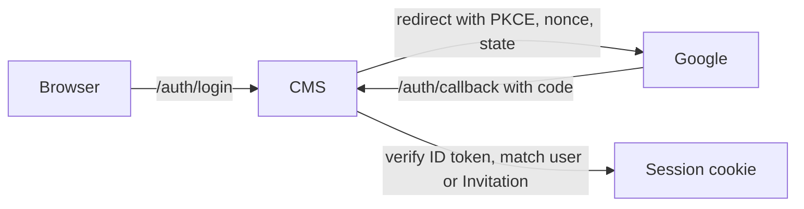

# Access

Who can use the CMS and for which Organizations: Google sign-in, the Super Admin, Moderators and their Invitations, sessions, and the Audit Log that records what they did. It uses the CMS, Storage and Google.

## How it works

### Sign-in

Google OIDC is the only identity provider in v1; Apple can follow as one more `IdentityProvider` adapter (it costs $99 a year and needs its client secret rotated at least every six months). The CMS runs the authorization code flow with PKCE, nonce and state, and verifies the ID token by hand: RS256 against the cached JWKS, then `iss`, `aud` (and `azp`), `exp`, `iat`, nonce and `email_verified`. PKCE verifier, nonce and state live in a short-lived signed cookie. A user is identified by issuer and subject, never by email. Locally, a dev OIDC stub replaces Google; it is compiled only with the `dev` build tag, and CI checks that the production binary does not contain it.

### Roles and Invitations

- The **Super Admin** is configured by the app setting `SUPER_ADMIN_EMAIL`, set at deploy from a GitHub secret (secrets are masked in logs, variables are not). It works as a permanent Invitation, bound to the Google `sub` on first sign-in, and can act as a Moderator of every Organization.
- A **Moderator** is invited by email for chosen Organizations. The Invitation is bound to the Google `sub` on first sign-in, because an email can change and `sub` cannot. It expires after 14 days if unused and can be revoked while pending. The CMS sends no email: the Super Admin passes the link on.
- The Super Admin can change a Moderator's Organizations or revoke all access. Removing an Organization from the person who created its Social Account Connection flags that connection for reconnection.
- Every use case checks the user's access to the Organization it touches.

### Sessions and request security

- The session cookie (`__Host-folkms`) is HMAC-signed, `HttpOnly; Secure; SameSite=Lax; Path=/`, valid for 8 hours. The user document is re-read on every request, so a revocation takes effect immediately; revocation also invalidates sessions issued before it.
- `SameSite=Lax`, not `Strict`, because a `Strict` cookie is not sent on the navigation back from Google. This is safe only because the CMS is same-origin; see [Platform](../platform/README.md#hosting).
- Unsafe methods are protected against CSRF: `Sec-Fetch-Site` must be `same-origin` when present, otherwise `Origin` must be the CMS origin. JSON bodies must be `application/json`.
- Sign-in endpoints are rate limited; responses carry a CSP and security headers.

### Audit Log

An append-only record of Event changes, Publish and Unpublish, Social Posts and access grants, in one append blob per day. Only the Super Admin can read it. It outlives Events purged from the Bin.

## Where it lives

| What | Path |
| --- | --- |
| Roles and Invitation lifecycle | [`cms/internal/domain/access.go`](../../cms/internal/domain/access.go), [`cms/internal/app/auth.go`](../../cms/internal/app/auth.go), [`cms/internal/app/access.go`](../../cms/internal/app/access.go) |
| Google and dev OIDC adapters | [`cms/internal/adapters/google/`](../../cms/internal/adapters/google/), [`cms/internal/adapters/devoidc/`](../../cms/internal/adapters/devoidc/) |
| Session cookie, CSRF, headers, rate limit | [`cms/internal/http/`](../../cms/internal/http/) |
| Moderators, Invitations and Audit Log screens | [`cms/admin/src/views/access.ts`](../../cms/admin/src/views/access.ts), [`cms/admin/src/views/audit.ts`](../../cms/admin/src/views/audit.ts) |

## Read next

- [Platform](../platform/README.md): hosting and secrets
- [Root README](../../README.md#operations): Google OAuth client and Super Admin bootstrap
- [CONTEXT.md](../../CONTEXT.md#access): the terms this capability uses
