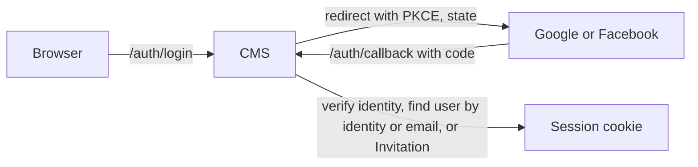

# Access

Who can use the CMS and for which Organizations: sign-in with Google or Facebook, the Super Admin, Moderators and their Invitations, sessions, and the Audit Log that records what they did. It uses the CMS, Storage, Google and Meta.

## How it works

### Sign-in

There are two identity providers, Google and Facebook, and the sign-in screen offers both (`/auth/login?provider=google|facebook`). Apple can follow as one more `IdentityProvider` adapter; it costs $99 a year and needs its client secret rotated at least every six months.

For Google, the CMS runs the authorization code flow with PKCE, nonce and state, and verifies the ID token by hand: RS256 against the cached JWKS, then `iss`, `aud` (and `azp`), `exp`, `iat`, nonce and `email_verified`. PKCE verifier, nonce and state live in a short-lived signed cookie. Facebook sign-in uses the Meta app that Sync and posting use ([ADR 0008](../architecture/adr/0008-facebook-sign-in-matched-by-email.md)). Its web login is plain OAuth, so there is no ID token. The CMS runs the code flow with state, redeems the code with the app secret, then reads `id`, `name` and `email` from Graph `/me`, signed with `appsecret_proof`, and drops the user token. The app is in Standard Access, so only Testers of the Meta app can sign in with Facebook.

The same `/auth/callback` serves both providers: the provider is in the signed state cookie, never taken from the query. A non-secret cookie remembers the last provider that worked, so an expired session and "Sign in again" go back to it.

A user's id comes from the issuer and subject it first signed in with. Another identity signs in as that user when it returns the same email, with one limit for Facebook, whose email carries no verified flag (T14): a Facebook identity seen for the first time is linked to an active user only when the browser already holds a valid session of that user. The Moderator signs in as before, then chooses *Link Facebook* in the sidebar; from then on the Facebook identity signs in on its own. Without that session the sign-in is refused and the Audit Log has `identity.link_refused`. A Google identity matched by email, and a Facebook identity redeeming an Invitation (a new or revoked user), need no link. Each first match is written to the Audit Log (`identity.matched`). A Facebook identity with no email is refused. The Super Admin is excluded from matching (see below).

Locally, a dev OIDC stub stands in for both Google and Facebook. It is compiled only with the `dev` build tag, and CI checks that the production binary does not contain it.

### Roles and Invitations

- The **Super Admin** is configured by the app setting `SUPER_ADMIN_EMAIL`, set at deploy from a GitHub secret (secrets are masked in logs, variables are not). It works as a permanent Invitation, bound to the Google identity it first signs in with, and can act as a Moderator of every Organization. It signs in only with that identity: never with Facebook (Meta's email field carries no verified flag), and never through email matching, also after its email changed.
- A **Moderator** is invited by email for chosen Organizations. The Invitation is bound to the identity, Google or Facebook, that redeems it on first sign-in. After that, a Google identity that returns the user's current email signs in as them, and a Facebook one once linked (see above). It expires after 14 days if unused and can be revoked while pending. The CMS sends no email: the Super Admin passes the link on.
- The Super Admin can invite, change a Moderator's Organizations, revoke an Invitation or revoke all access, each with a Recent sign-in (below). Revoking someone in the CMS does not remove them from the Meta app: also remove their *Tester* role (Meta app → *App roles*), or they can still sign in with Facebook if invited again, and connect, sync or post with their own Meta sign-in wherever they keep a page role. When that person is the one who turned Autosync on for an Organization they lose, Autosync turns off at once and its Facebook page token is deleted (decision 19); see [Social posting](../social-posting/README.md#autosync).
- Every use case checks the user's access to the Organization it touches.

### Sessions and request security

- The session cookie (`__Host-folkms`) is HMAC-signed, `HttpOnly; Secure; SameSite=Lax; Path=/`, valid for 8 hours. It carries a random nonce drawn at sign-in, whose SHA-256 hash is on the user document with the sign-in time (the last 16 are kept, one per device or browser). The user document is re-read on every request, and a session counts only if its nonce is there: so a cookie forged with a leaked `SESSION_KEY` is refused outright (T5), signing out deletes the record and ends that session for good, also for a copied cookie, and a revocation takes effect immediately.
- Store keys never come straight from a request: ids in the path must be plain names (`[A-Za-z0-9_-]`), use cases check the id's shape and that a loaded Event names the Organization and id it was asked for, and every store adapter refuses dot segments, empty segments and other characters (T13).
- `SameSite=Lax`, not `Strict`, because a `Strict` cookie is not sent on the navigation back from Google. This is safe only because the CMS is same-origin; see [Platform](../platform/README.md#hosting).
- Unsafe methods are protected against CSRF: `Sec-Fetch-Site` must be `same-origin` when present, otherwise `Origin` must be the CMS origin. JSON bodies must be `application/json`.
- A sign-in started from another site (`Sec-Fetch-Site: cross-site`) shows a page with a sign-in button instead of going to the provider, so no site can renew a Recent sign-in or push out sessions silently.
- Sign-in and timer endpoints are rate limited per client address (IPv6 per /64), and changing API requests to 60 a minute per user; responses carry a CSP and security headers.

### Recent sign-in

While an Organization has Autosync on, the CMS keeps a Facebook page token that can post on its behalf ([ADR 0010](../architecture/adr/0010-autosync-keeps-a-page-token-in-key-vault.md)). A session cookie can be copied while it is valid, so a session alone is not enough for actions that use or change that token, or that change who has access (T5). These need a Recent sign-in, a real Google or Facebook sign-in in the last 15 minutes:

- posting a Social Post with the stored token,
- turning Autosync on or off,
- replacing or disconnecting the Social Account Connection while Autosync is on,
- inviting, changing a Moderator's Organizations, revoking an Invitation or a Moderator (the Super Admin).

The time comes from the sign-in record the session's nonce points to (above), checked on the server. When the sign-in is older, the API answers so and the SPA sends the Moderator to sign in again. While Autosync is off, the Meta sign-in each action needs is the guard instead, as under [ADR 0005](../architecture/adr/0005-meta-sign-in-for-every-post.md). `SESSION_KEY` is itself a Key Vault reference ([Platform](../platform/README.md#infrastructure-and-cicd)).

### Admin UI language

The admin SPA and the CMS's own pages (sign-in errors, privacy, data deletion) are in Polish or English. The language comes from the user's browser settings: the first of Polish or English among the browser's preferred languages (`navigator.languages` in the SPA, `Accept-Language` on the server), else English. The switch in the header overrides it for a year in the `folkms-lang` cookie, which the SPA sets and the server reads, and reloads the page in that language.

The API does not depend on the language: every message it returns (errors, validation problems) carries both Polish and English, and the SPA shows the one it uses. This is independent of Event content, which is authored in Polish with optional English for Sites.

### Audit Log

An append-only record of Event changes (Overrides, CMS-only fields, Hide, Manual Events, the Bin), every Sync run, Social Posts and refusals, Autosync and connection changes, and access grants, in one append blob per day; when a day's blob is full (50,000 lines), it goes on in `<day>.2.log` and so on. Every use of a stored Facebook page token is in it, with the acting Moderator or `autosync`: the line `autosync.token_used` is written before the token is read, and the token is not used when it cannot be written (T8). Other lines are best effort. Only the Super Admin can read it. It outlives Events purged from the Bin. The CMS identity could rewrite it; every write to the `cms` container by any other identity raises an alert, and earlier versions of a rewritten blob are kept 90 days ([Platform](../platform/README.md#hosting)).

## Where it lives

| What | Path |
| --- | --- |
| Roles, Invitation lifecycle, Recent sign-in | [`cms/internal/domain/access.go`](../../cms/internal/domain/access.go), [`cms/internal/app/auth.go`](../../cms/internal/app/auth.go), [`cms/internal/app/access.go`](../../cms/internal/app/access.go) |
| Google, Facebook and dev OIDC adapters | [`cms/internal/adapters/google/`](../../cms/internal/adapters/google/), [`cms/internal/adapters/meta/signin.go`](../../cms/internal/adapters/meta/signin.go), [`cms/internal/adapters/devoidc/`](../../cms/internal/adapters/devoidc/) |
| Session cookie, CSRF, headers, rate limit | [`cms/internal/http/`](../../cms/internal/http/) |
| Admin UI language: choice, switch and server pages | [`cms/admin/src/i18n.ts`](../../cms/admin/src/i18n.ts), [`cms/internal/http/lang.go`](../../cms/internal/http/lang.go) |
| Moderators, Invitations and Audit Log screens | [`cms/admin/src/views/access.ts`](../../cms/admin/src/views/access.ts), [`cms/admin/src/views/audit.ts`](../../cms/admin/src/views/audit.ts) |

## Change together

| Rule | Files | What breaks |
| --- | --- | --- |
| The SPA and the server use the same language cookie | `cms/admin/src/i18n.ts`, `cms/internal/http/lang.go` | Server pages ignore the language chosen in the SPA. Enforced by `TestLangCookieMatchesAdmin` in `cms/internal/http`. |

## Read next

- [Platform](../platform/README.md): hosting and secrets
- [ADR 0008](../architecture/adr/0008-facebook-sign-in-matched-by-email.md): Facebook sign-in, users matched by email
- [ADR 0010](../architecture/adr/0010-autosync-keeps-a-page-token-in-key-vault.md): why a Recent sign-in guards the stored token
- [Root README](../../README.md#operations): Google OAuth client, Meta app and Super Admin bootstrap
- [CONTEXT.md](../../CONTEXT.md#access): the terms this capability uses
