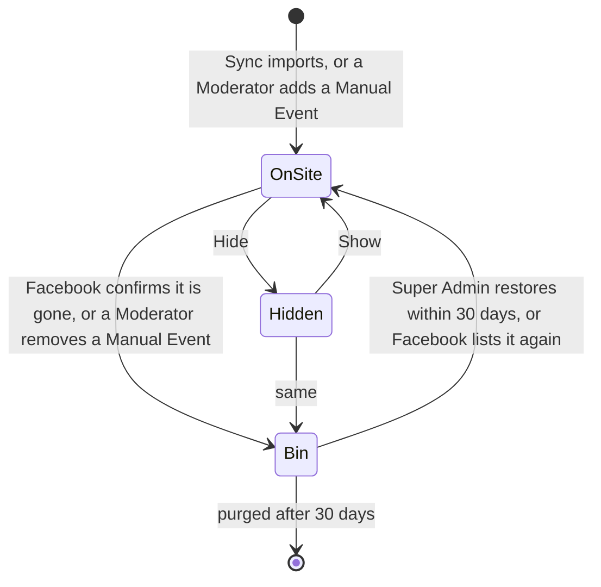

# Event management

What Moderators do with an Organization's Events: synced Events come from its Facebook page through [Sync](../sync/README.md), and a Moderator adds what Facebook lacks, overrides a Facebook value where needed, hides an Event, or enters a Manual Event for a co-hosted Facebook Event that Sync cannot read. There is no Draft, Publish, Recurrence, Venue list or Duplicate: a Facebook Event is created and edited on Facebook ([ADR 0009](../architecture/adr/0009-facebook-events-are-the-source-of-events.md)). It uses the CMS, the admin SPA and Storage.

## How it works

### Lifecycle

An Event is synced (created by Sync) or a Manual Event (created by a Moderator). Either is on its Site at once, and every change goes live on save: each change rebuilds the Organization's snapshot ([Site delivery](../site-delivery/README.md)).

- **Hide** keeps an Event off its Site. Sync never undoes it. A Hidden Event, like one in the Bin, cannot be posted, because the Social Post would link to a Permalink that does not exist.
- Every change is appended to the Audit Log; see [Access](../access/README.md#audit-log).

### Synced Events: Overrides and CMS-only fields

A synced Event's Facebook part (name, description, Location, Cover Image, ticket link, Occurrences, cancellation) is written only by Sync and shown read-only. Beside each overridable field the Moderator can:

- **Override** it: name, description, Location, Cover Image or ticket link. The Override wins on the Site and in Captions. Dates and cancellation can never be overridden.
- **Follow Facebook again**, which removes the Override.

Each Override remembers the Facebook value it replaced. When Facebook later changes that field, the Override stays and the Event is flagged with the changed fields; the Moderator keeps the Override (confirming it against the new Facebook value) or follows Facebook again.

The CMS adds what Facebook lacks: English name and description, Summary (Polish and English), Price text (Polish and English) and a Social Image. Facebook's text is the Polish content; Sites apply the Translation fallback. The English texts and the Summary remember the Facebook name and description they were written against. When Facebook changes either, the Event is flagged as possibly out of date (decision 16); the Site keeps showing them meanwhile, and the Moderator updates them or dismisses the flag.

### Effective values

What the Site, Captions and the Event list show is the effective value: the Override, else the Facebook value; the Moderator's values for a Manual Event; English and the Summary from the CMS fields. English is never shown without Polish. A cancelled Facebook Event cancels all its Occurrences, and an Event whose Occurrences are all cancelled is cancelled.

### Manual Events

A Facebook Event another Facebook page created, typically one the Organization co-hosts, cannot be read by Sync. A Moderator enters it by hand (decision 20): Polish and English name and description, Location, Cover Image upload, ticket link, Occurrences, the CMS-only fields and the required link to its Facebook Event.

- **Dates** are entered one by one, without Recurrence rules: a start date and time and an optional end. An end time not after the start without an end date means the next day (a bal ending after midnight); one Occurrence lasts at most 31 days; an Event has at most 100 Occurrences. Each can be marked cancelled.
- **The Facebook link** is accepted only as a Facebook event address (`facebook.com`, `www.`, `m.` or `web.`) or a bare numeric id, and stored as `https://www.facebook.com/events/{id}/`. The CMS never fetches it (T9). It cannot be changed later: remove the Manual Event and add another.
- **One Facebook Event, one Event.** The Manual Event claims its Facebook Event id in the same create-only index Sync uses, so a Facebook Event is never both synced and manual, and cannot be added twice. When Sync finds that id on the connected page, it leaves the Manual Event alone and the Event list flags it; the Moderator decides which to keep.
- Sync never reads or writes a Manual Event: the Moderator keeps it up to date. Hide and the Bin work as for synced Events; Social Posts too.

### The Bin

- **Synced Events** go to the Bin only when Sync confirms their Facebook Event is gone: Graph answers code 100, subcode 33 for it, and the same run listed the page's events successfully with the same token (decision 11, see [Sync](../sync/README.md#one-run)). Anything else changes nothing. A Moderator cannot remove a synced Event: they hide it, or delete the Facebook Event on Facebook.
- **Manual Events** go to the Bin when a Moderator removes one. While it is there, its Facebook Event cannot be added again; the Super Admin restores it instead.
- The Super Admin can restore an Event within 30 days. A restored synced Event goes back to the Bin if the next Sync confirms it is still gone; one Facebook lists again comes back by itself.
- The daily timer `purge` removes Events that have been in the Bin for 30 days, with their Social Post records and index documents. The Audit Log keeps their history, including Facebook and Instagram URLs. Nothing is ever removed from Facebook or Instagram.

### Concurrent edits

A Manual Event and the CMS-only fields are saved with the ETag the screen loaded, so two Moderators cannot overwrite each other: the second save conflicts. Single-field changes (an Override, Follow Facebook again, Hide, dismissing a flag) apply to the latest version. Sync writes only the Facebook part, with ETag retry, so it never loses a Moderator's edit.

### Permalink

The Permalink is `/<lang>/events/<shortId>-<slug>`. The `shortId` is drawn at first import or creation (`crypto/rand`, base32, 8 characters) and claimed with a create-only index document, so it is unique per Organization and never changes. The slug comes from the effective Polish name and may change without breaking the Permalink.

### The Event list

Views: upcoming, past, Hidden and the Bin. Flags: Hidden, cancelled, manual, Override changed on Facebook, CMS text possibly out of date, from a former Facebook page, Facebook Event held by a Manual Event, in the Bin. The list also shows the sync status with "Sync now", "Add co-hosted event", and the reconnect and "reconnect before" banners of the Social Account Connection ([Social posting](../social-posting/README.md#autosync)).

### Images

Facebook covers are imported by Sync. A Moderator uploads a Cover Image for a Manual Event or a cover Override, and a Social Image (1:1 or 4:5) for Instagram. The CMS decodes JPEG, PNG and WebP (`golang.org/x/image`), enforces limits against decompression bombs (15 MB, 50 Mpx, checked from the header before decoding), resizes and re-encodes JPEG variants, because Instagram requires JPEG at a public URL. HEIC is rejected with a clear error. A Cover Image gets widths 480, 960 and 1600 (never upscaled) plus an Instagram crop within 4:5–1.91:1; a Social Image is center-cropped to 1:1 or 4:5. Variants go to `pub/media/<org>/` under immutable, content-hashed names.

### Storage

Documents in the `cms` container (under `data/` in Azure, `.data/cms/` locally), see [ADR 0002](../architecture/adr/0002-blob-json-documents-with-etag.md):

| Key | What |
| --- | --- |
| `orgs/{org}/events/{id}.json` | The Event: Facebook part or Manual part, Overrides, CMS-only fields, Hidden, Bin state |
| `orgs/{org}/facebook-events/{facebook id}.json` | Create-only index: which Event holds a Facebook Event id |
| `orgs/{org}/shortids/{shortId}.json` | Create-only index: which Event holds a `shortId` |
| `orgs/{org}/sync/status.json` | Sync status and lease ([Sync](../sync/README.md#the-lease-t10)) |
| `orgs/{org}/posts/{event id}.json` | The Event's Social Post records ([Social posting](../social-posting/README.md)) |

## Where it lives

| What | Path |
| --- | --- |
| Event aggregate: effective values, Overrides, flags, Manual Events, the Bin | [`cms/internal/domain/event.go`](../../cms/internal/domain/event.go) |
| Facebook link parsing, text cleaning, `shortId` | [`cms/internal/domain/common.go`](../../cms/internal/domain/common.go) |
| Use cases, per-Organization authorization, index documents, purge | [`cms/internal/app/events.go`](../../cms/internal/app/events.go) |
| Storage keys | [`cms/internal/app/app.go`](../../cms/internal/app/app.go) |
| Routes | [`cms/internal/http/api.go`](../../cms/internal/http/api.go) |
| Image processing | [`cms/internal/adapters/img/`](../../cms/internal/adapters/img/) |
| Event list and Event screens | [`cms/admin/src/views/`](../../cms/admin/src/views/) |

## Change together

| Rule | Files | What breaks |
| --- | --- | --- |
| A Facebook Event link is always `https://www.facebook.com/events/{numeric id}/` | `cms/internal/domain/common.go` (`FacebookEventURL`, `ParseFacebookEventLink`), `contract/events.schema.json` (`facebookEventUrl` pattern) | Snapshots fail validation and are not written. Enforced by `TestSnapshotMatchesSchema` in `cms/internal/domain`. |
| The overridable field names are the same in the API and the SPA | `cms/internal/domain/event.go` (`OverrideFields`, `Field*`), the Event screen in `cms/admin/src/views/` | An Override control is refused as "unknown field". Not enforced by a test. |
| The Event list knows every flag | `cms/internal/domain/event.go` (`Flags` JSON names), `cms/admin/src/views/events.ts` | A flag is silently not shown. Not enforced by a test. |
| A validation problem's `field` path has a matching `data-field` or `name` | `cms/internal/domain/event.go`, the view's form | See [Design system, Change together](../design-system/README.md#change-together). |
| Storage keys of Events and their index documents | `cms/internal/app/app.go`, the one-off upgrade step in the [root README](../../README.md#upgrade-notes) | The runbook deletes the wrong documents. |

## Read next

- [Sync](../sync/README.md): how synced Events are created, updated and binned
- [Site delivery](../site-delivery/README.md): what every change produces
- [ADR 0009](../architecture/adr/0009-facebook-events-are-the-source-of-events.md): why Facebook is the source of Events
- [ADR 0002](../architecture/adr/0002-blob-json-documents-with-etag.md): how Events are stored
- [CONTEXT.md](../../CONTEXT.md#event-management): the terms this capability uses
