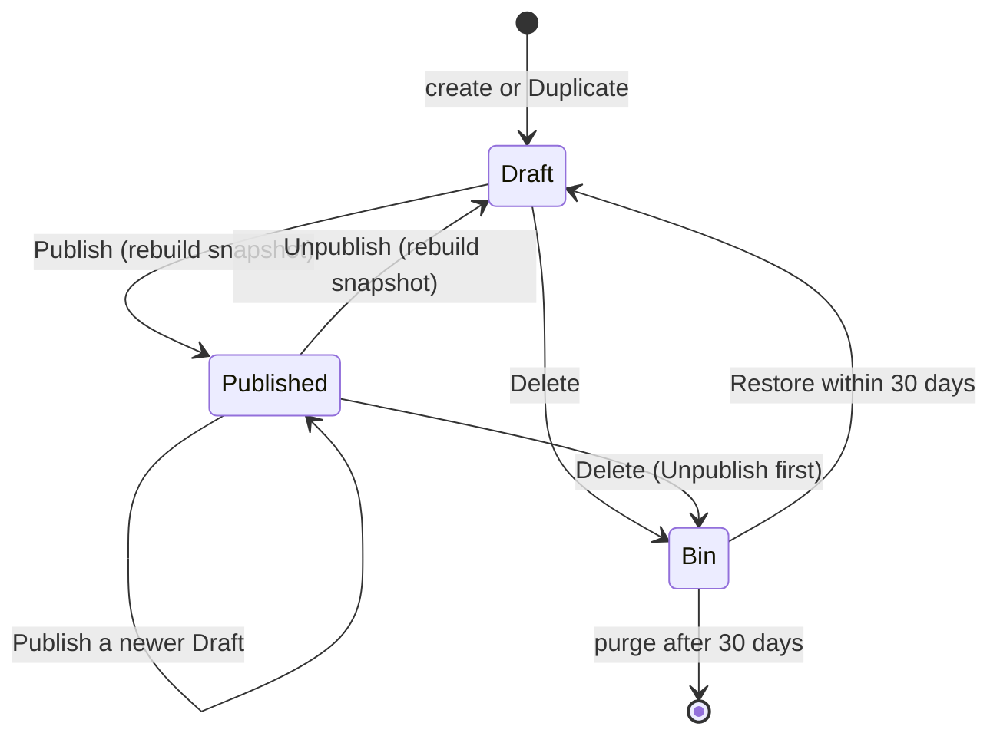

# Event management

How Moderators author an Organization's Events and decide what its Site shows: Drafts, Publish and Unpublish, Recurrences and Occurrences, Venues, Prices, images, Duplicate and the Bin. It is the core of the CMS and uses the CMS, the admin SPA and Storage.

## How it works

### Lifecycle

An Event is edited as a Draft. Publish makes the current Draft the version its Site shows; editing a Published Event creates a new Draft, and the Site keeps the previously published version until the next Publish. Unpublish removes the Event from the Site and keeps it in the CMS as a Draft. Delete moves the Event to the Bin, Unpublishing it first if it was Published.

- Every Publish and Unpublish rebuilds the Organization's snapshot; see [Site delivery](../site-delivery/README.md).
- Every transition is appended to the Audit Log; see [Access](../access/README.md).
- A daily timer trigger purges Events that have been in the Bin for 30 days, with their Social Post records. The Audit Log keeps their history, including Facebook and Instagram URLs. Deleting never removes anything from Facebook or Instagram.
- Duplicate creates a new Draft from an existing Event, copying content but not dates or Social Posts.

### Event kinds and Occurrences

An Event is single, Multi-day or Recurring. A Recurrence is weekly, every second week, or monthly on the Nth or last weekday, with a mandatory start and end date at most 24 months apart. Because the end is mandatory, all Occurrences are expanded at Publish, in `Europe/Warsaw` and correct across DST changes; no job rolls a horizon forward. Each Occurrence of a Recurring Event can be cancelled or overridden on its own.

### Content and validation

- Polish is required, English optional; Sites apply the Translation fallback.
- Price is free bilingual text with an optional tickets or registration link.
- The Permalink is `/<lang>/events/<shortId>-<slug>`. The `shortId` is generated at creation (`crypto/rand`, base32, 8 characters, collision-checked per Organization) and never changes; the slug is editable and cosmetic, and must be unique per Organization.

### Venues

Venues are a reusable list per Organization. Published Events reference a Venue by id, so editing a Venue immediately applies to every not-yet-happened Occurrence, single or recurring, and rebuilds the affected snapshots. Before the edit is applied, past Occurrences of affected Events get a frozen copy of the Venue as it was. Venues are archived, never deleted.

### Images

An Event has a landscape Cover Image and an optional Social Image (1:1 or 4:5) for Instagram. The CMS decodes JPEG, PNG and WebP (`golang.org/x/image`), enforces size and pixel limits against decompression bombs, resizes, and re-encodes JPEG variants, because Instagram requires JPEG at a public URL. HEIC is rejected with a clear error. Variants go to `pub` under immutable, content-hashed names.

## Where it lives

| What | Path |
| --- | --- |
| Event aggregate, Recurrence, Occurrence expansion, Publish rules | `cms/internal/domain/` |
| Use cases and per-Organization authorization | `cms/internal/app/` |
| Image processing | `cms/internal/adapters/img/` |
| Event editor and lists | `cms/admin/` |

## Read next

- [Site delivery](../site-delivery/README.md): what Publish produces
- [CONTEXT.md](../../CONTEXT.md#event-management): the terms this capability uses
