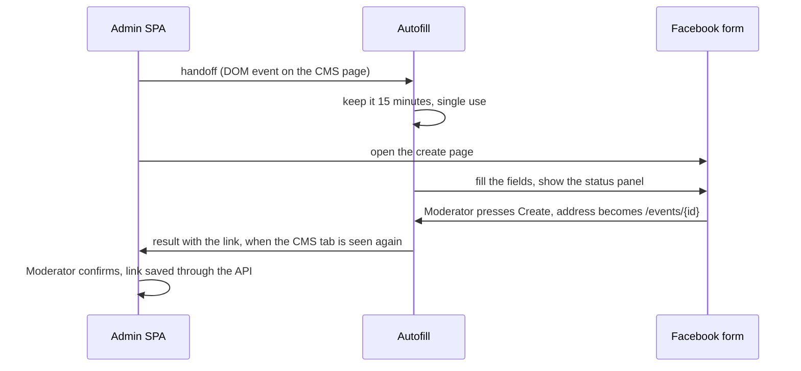

# Facebook events

How a Moderator turns a Published Event into a Facebook Event hosted by the Organization's Facebook page, and how the CMS keeps its link. The CMS cannot create Facebook Events (see [ADR 0006](../architecture/adr/0006-facebook-events-through-handoff-and-autofill.md)): it prepares a Facebook Event Handoff, the Moderator creates the Facebook Event on Facebook, optionally with Autofill typing the fields, and the CMS records the link. It uses the CMS, the admin SPA, Storage, the contract and the Sites, plus Autofill, a browser helper outside the CMS.

## How it works

### The Handoff

Any Moderator of the Organization, or the Super Admin, opens the Handoff from the editor or the event list of a Published Event. It needs the Social Account Connection: its Facebook page hosts the Facebook Event, and the screen reminds the Moderator to act as that Facebook page on Facebook.

The CMS generates the fields for the next upcoming, non-cancelled Occurrence: the Polish name (editable, at most 100 characters), start and end in the Organization's time zone, the Venue as location text, a description (Polish, then English when present, the Price, the further dates of a Recurring Event, the Permalinks; editable), the ticket link from the Price and the Cover Image's largest variant (served same-origin, because the CMS allows only `connect-src 'self'`). Each field has a copy button; "Open Facebook" opens the create page in a new tab. This works on every device.

With the fields the CMS returns a handoff token: the source values (`HandedOver`: Polish title, Occurrence start and end, Venue name and address, cancelled) and the Occurrence key, HMAC-signed with the session key and valid 24 hours. A link saved with a valid token keeps the values the Facebook Event was really created from; without one the server takes the current values. Values from the client are never trusted.

### Autofill

Autofill is optional. When the SPA detects it, "Fill on Facebook" hands it the fields, the Cover Image, the field map and the return address; Autofill fills Facebook's own form and the Moderator presses Create. Nothing is put in a Facebook URL and Autofill never calls the CMS API.

- **Builds:** one codebase in `autofill/`. A Manifest V3 WebExtension for desktop Chrome/Edge and Firefox, built for one CMS origin; and a userscript the CMS serves at `/app/autofill.user.js` with its origin filled in, for desktop and phones (Firefox for Android with Violentmonkey; iOS userscript managers on a best-effort basis). When both are installed, the second to load sees the first's marker on `<html>` and stays idle.
- **Transport:** the SPA and Autofill talk through `CustomEvent`s on `document` with JSON-string details (`autofill/src/protocol.ts`). Only a page on the CMS origin can store a handoff. Results and failure reports wait in Autofill's storage until a CMS page is visible or focused, or the open Handoff polls; the SPA acknowledges them.
- **On Facebook:** Autofill waits for the form, finds each field through the field map (ordered locators by ARIA role and Polish or English label, never class names), types it, checks what Facebook kept, and shows a panel: each field as filled, needs you or failed, copy buttons, the "act as the Facebook page" reminder, and a warning when the browser's time zone differs from the Organization's. It never presses Create, then watches the address for `/events/{id}`.
- **Breakage** degrades to a partial fill. Failed fields are reported to the CMS, which appends them to the Audit Log (`autofill.reported`).
- **Field map:** `autofill/fieldmap.json` is embedded in the admin build and travels with each handoff, so most fixes to Facebook form changes need only a CMS deploy.

### Links and later changes

The Moderator confirms the link Autofill brought back, or pastes it. The CMS normalises it to `https://www.facebook.com/events/{id}/` and keeps it on the Event against the Occurrence, with who recorded it and when. Links can be changed, re-attached to another Occurrence or removed; the Facebook Event itself stays on Facebook. Every change is in the Audit Log and rebuilds the snapshot.

- **On the Site:** the snapshot gives the Occurrence an optional `facebookEventUrl`, and both Sites show a "Facebook event" link. Captions do not use it.
- **Out of date:** on reading, the CMS compares `HandedOver` with the current Published version (Venues resolved as the snapshot resolves them, past Venues included). When they differ, or the Event is Unpublished or Binned, the Handoff and the event list flag the Facebook Event and show the changed fields with copy buttons. The Moderator edits it on Facebook by hand and dismisses the flag, which takes the current values as the new `HandedOver`.
- **Moved dates:** on a Single or Multi-day Event, the link follows the only Occurrence and is flagged. On a Recurring Event, a link whose Occurrence no longer exists is detached: kept, flagged, hidden from the Site and shown first on the Handoff, until the Moderator re-attaches or removes it.
- **Recurring Events** get one Facebook Event at a time, for the next Occurrence; once it has passed the Handoff offers the next one.

## Where it lives

| What | Path |
| --- | --- |
| Links, resolution, out of date, field generation | [`cms/internal/domain/facebookevent.go`](../../cms/internal/domain/facebookevent.go) |
| Use cases, handoff token, Autofill reports | [`cms/internal/app/facebookevents.go`](../../cms/internal/app/facebookevents.go) |
| Routes; userscript serving | [`cms/internal/http/api.go`](../../cms/internal/http/api.go), [`cms/internal/http/static.go`](../../cms/internal/http/static.go) |
| Handoff screen; SPA side of the protocol | [`cms/admin/src/views/facebookEvent.ts`](../../cms/admin/src/views/facebookEvent.ts), [`cms/admin/src/autofill.ts`](../../cms/admin/src/autofill.ts) |
| Autofill: protocol, fill engine, field map, builds | [`autofill/`](../../autofill/) |
| Dev-only practice page (`/dev/facebook/events/create/`) | [`cms/cmd/cms/practice/`](../../cms/cmd/cms/practice/) |
| `facebookEventUrl` in the contract | [`contract/events.schema.json`](../../contract/events.schema.json) |

## Change together

| Rule | Files | What breaks |
| --- | --- | --- |
| The SPA and Autofill speak the same protocol | `autofill/src/protocol.ts`, `cms/admin/src/autofill.ts` | Handoffs or results are lost. Enforced: the SPA imports the protocol module, so the type-checker catches a mismatch. |
| The field map's labels match Facebook's form and the practice page | `autofill/fieldmap.json`, `cms/cmd/cms/practice/form.js` | Autofill fails on Facebook. The practice page is for the engine only; Facebook itself is checked by hand with the per-release checklist in the [root README](../../README.md#autofill). |
| The userscript's origin placeholder | `autofill/lib.ts`, `cms/internal/http/static.go` | The userscript runs on no CMS page. Enforced by `TestAutofillConstantsMatch` in `cms/internal/http`. |
| The name limit | `cms/internal/domain/facebookevent.go`, `cms/admin/src/views/facebookEvent.ts` | Facebook cuts or refuses the name. Enforced by `TestAutofillConstantsMatch`. |

`facebookEventUrl` follows the snapshot contract rule in [Site delivery](../site-delivery/README.md#change-together).

## Read next

- [ADR 0006](../architecture/adr/0006-facebook-events-through-handoff-and-autofill.md): why a Handoff and Autofill, and the spike results
- [Social posting](../social-posting/README.md): the Social Account Connection
- [Site delivery](../site-delivery/README.md): the snapshot the link appears in
- [Root README](../../README.md#autofill): publishing and installing Autofill, the terms risk, the release checklist
- [CONTEXT.md](../../CONTEXT.md#social-posting): Facebook Event, Facebook Event Handoff, Autofill
