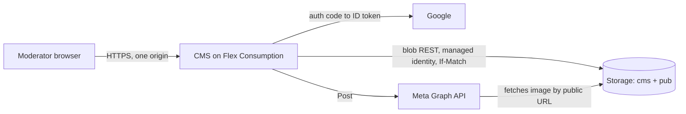

# Platform

Where folk-ms runs and how it is built: Azure hosting for the CMS and the Sites, the ports that keep the domain independent of Azure, the dependency policy, infrastructure as code, CI/CD and local development. Every capability builds on it.

## How it works

### Hosting

The read path and the write path are separate. Visitors only ever touch the Sites and the public `pub` container, so a CMS outage never takes a Site down; the Site keeps showing the last Publish.

- **CMS:** one Azure Functions Flex Consumption app running the Go binary as a custom handler. `host.json` sets `routePrefix: ""` and request forwarding, and one HTTP function with the route `{*path}` hands every request to the binary; a timer function `purge` runs the daily Bin purge as `POST /purge`. The admin SPA, the API and sign-in share one origin, so cookies are first-party (`SameSite=Lax`) and no CORS is needed. Same-origin also avoids the cross-site cookie problems of the `*.azurewebsites.net` public suffix. The free grant (100k GB-s, 250k executions) covers the admin traffic of a few Moderators. Scale-to-zero costs about 1–2 s on the first request, which is acceptable for an admin UI. See [ADR 0004](../architecture/adr/0004-same-origin-admin-on-flex-custom-handler.md) for what the local spike verified and what remains to check in Azure.
- **Sites:** Azure Static Web Apps Free, one app per Site, with no functions and no SWA auth. The free tier gives 10 apps, 100 GB a month and free TLS on two custom domains each.
- **Storage:** one storage account with shared-key access disabled. The private container `cms` holds JSON documents (Events, Venues, users, Invitations, Social Account Connections; no Meta token, see [Social posting](../social-posting/README.md)) under `data/` and the Audit Log under `audit/`. The public container `pub` holds snapshots and media. Blob versioning and soft delete (30 days) are on; old versions expire after 90 days.
- **Data store:** JSON documents with optimistic concurrency through ETag and `If-Match`; see [ADR 0002](../architecture/adr/0002-blob-json-documents-with-etag.md).

### Ports and adapters

The domain and the use cases depend only on ports ([`cms/internal/ports`](../../cms/internal/ports/ports.go)). Only the composition root ([`cms/cmd/cms`](../../cms/cmd/cms/main.go)) picks adapters, from `FOLKMS_ENV` (`azure` or `local`); it also detects whether it runs under the Functions host (`FUNCTIONS_CUSTOMHANDLER_PORT`) or as a plain server (`PORT`). Moving to a VPS changes that wiring and the deployment, not the domain.

| Port | Azure | VPS or local | Tests |
| --- | --- | --- | --- |
| `DocumentStore` (Get/Put with ETag, List by prefix, Delete) | blob REST, managed identity (`azblob`) | files, atomic rename and lock file (`fs`) | `memory` |
| `PublicStore` (snapshots, media) | blob container `pub` | directory served at `/pub/` | `memory` |
| `AppendLog` (Audit Log) | append blobs, one per day | `O_APPEND` file per day | `memory` |
| `IdentityProvider` | Google (`google`), Facebook (`meta.SignIn`) | Google and Facebook, or the dev OIDC stub for both (`devoidc`, build tag `dev`) | fake |
| `SocialPublisher` | Meta Graph API (`meta`) | Meta Graph API, or the recorder when `META_APP_ID` is unset | recorder |
| `ImageProcessor` | `img` (JPEG, PNG, WebP in; JPEG out) | same | same |

All store adapters run one shared contract suite ([`storetest`](../../cms/internal/adapters/storetest/storetest.go)); the blob adapter runs it against Azurite.

### Dependency policy

See [ADR 0003](../architecture/adr/0003-stdlib-only-go.md) for what may be depended on and [ADR 0007](../architecture/adr/0007-latest-toolchains-and-dependabot-cooldown.md) for how versions are kept current. In short:

- **Go:** standard library and `golang.org/x/*` only, fetched as modules and verified by `go.sum`, checked with `govulncheck` in CI. CI builds with the latest stable Go. No Azure SDK and no OIDC or JWT libraries.
- **TypeScript** (admin SPA, Sites, contract reader): built, tested and served with Bun; CI installs the latest release with [`.github/scripts/setup-bun.sh`](../../.github/scripts/setup-bun.sh). Zero npm runtime dependencies; the only npm package is the dev-only `typescript` type-checker, locked with integrity in `package-lock.json` and installed with `npm ci --ignore-scripts`.
- **GitHub Actions:** only `actions/*`, pinned by commit SHA.
- **Updates:** Dependabot updates the actions, `typescript` and the Go modules with a 7-day cooldown ([`.github/dependabot.yml`](../../.github/dependabot.yml)). Azure sign-in uses the Azure CLI with the workflow's OIDC token, not a third-party action.

### Infrastructure and CI/CD

Bicep in [`infra/azure/main.bicep`](../../infra/azure/main.bicep) declares the storage account (containers, CORS on blobs for Site origins, versioning, soft delete, lifecycle), the Flex app with its system-assigned identity and `Storage Blob Data Owner` role (the Functions host keeps its leases in the same account, which needs Owner), and one Static Web App per Site. GitHub Actions deploys through OIDC federated credentials, so no Azure secret is stored. Secrets (session key, Google and Meta client secrets, `SUPER_ADMIN_EMAIL`) are app settings set at deploy from GitHub environment secrets; none is in the repository.

Workflows in [`.github/workflows`](../../.github/workflows/):

- `ci.yml`: Go vet, test (with Azurite as a service), `govulncheck`, a check that `go.mod` and `go.sum` are tidy, a check that the production binary has no dev sign-in; `tsc -b`; Bun tests (contract reader, Site routes); admin and Site builds; Bicep build.
- `deploy-infra.yml`: `main.bicep` with Site ids and origins computed from `config/sites.json`.
- `deploy-cms.yml`: tests, `cms/deploy/package.sh` (Linux binary + `host.json` + function folders + `sites.json`), zip deploy, health check.
- `deploy-site.yml`: a matrix of the Site ids in `config/sites.json`, with path filters; the snapshot URL is baked in at build time.

### Local development

`scripts/dev.sh` runs the CMS on http://localhost:8080 with filesystem stores in `.data/`, the dev OIDC stub (any email signs in; `SUPER_ADMIN_EMAIL` defaults to `admin@example.org`) and the Meta recorder. It serves the public store at `/pub/` with the same cache headers and CORS as Azure, so a Site built by `bun sites/build.ts <site>` and served by `bun sites/serve.ts <site> 5173` reads its snapshot from the local CMS. An Azurite container, pinned by digest in `ci.yml`, runs the blob adapter tests; setting `STORAGE_BLOB_URL` and `STORAGE_ACCOUNT_KEY` runs the local CMS against it. Commands are in the [root README](../../README.md#local-development).

### Cost

| Item | Basis | Monthly |
| --- | --- | --- |
| Static Web Apps Free × 2 | Free plan | $0 |
| Flex Consumption | Far below the free grant | $0 |
| Storage: deployment, data, media | Under 1 GB, under 100k transactions (unconfirmed third-party price data) | < $0.50 |
| Egress to visitors | Small snapshot; images are the main egress; first 100 GB free | ~$0 |
| Google OIDC, Meta app, GitHub Actions (public repository) | Free | $0 |
| **Total** | | **< $1** |

### Open risks

- **Flex specifics.** The catch-all route, cookie passthrough and the timer were verified on the Functions host locally (ADR 0004); `SameSite=Lax` after the Google redirect, cold start and managed identity still need a real Flex app. Fallback: Azure Container Apps running the same binary.
- **Meta Standard Access for `pages_manage_posts`.** Very likely fine for app-role holders, but not stated explicitly. See [Social posting](../social-posting/README.md).
- **Per-Organization CMS domains.** Flex allows at most 3 managed certificates per app, which is enough for 2–3 Organizations. Sessions are per host.
- **Single snapshot growth.** One `events.json` per Site is fine for years; revisit later.

## Where it lives

| What | Path |
| --- | --- |
| Composition root | [`cms/cmd/cms/`](../../cms/cmd/cms/) |
| Ports | [`cms/internal/ports/`](../../cms/internal/ports/) |
| Adapters | [`cms/internal/adapters/`](../../cms/internal/adapters/) (`azblob/`, `fs/`, `memory/`, `google/`, `devoidc/`, `meta/`, `img/`, `storetest/`) |
| HTTP layer | [`cms/internal/http/`](../../cms/internal/http/) |
| Functions package | [`cms/deploy/`](../../cms/deploy/) |
| Go dependencies | [`cms/go.mod`](../../cms/go.mod) |
| Dependency updates | [`.github/dependabot.yml`](../../.github/dependabot.yml) |
| Infrastructure | [`infra/azure/main.bicep`](../../infra/azure/main.bicep) |
| Workflows | [`.github/workflows/`](../../.github/workflows/) |

## Change together

| Rule | Files | What breaks |
| --- | --- | --- |
| The Functions package layout matches the binary | `cms/deploy/functions/host.json` (`defaultExecutablePath`), `cms/deploy/package.sh` | The host cannot start the handler; the deploy smoke test fails. |
| Each Static Web App carries the tag `folkms-site=<site id>` that the deploy finds it by | `infra/azure/main.bicep`, `.github/workflows/deploy-site.yml` | The Site deploy fails with "no Static Web App tagged". |
## Read next

- [ADR 0002](../architecture/adr/0002-blob-json-documents-with-etag.md), [ADR 0003](../architecture/adr/0003-stdlib-only-go.md), [ADR 0004](../architecture/adr/0004-same-origin-admin-on-flex-custom-handler.md), [ADR 0007](../architecture/adr/0007-latest-toolchains-and-dependabot-cooldown.md)
- [Site delivery](../site-delivery/README.md): the read path in detail
- [Access](../access/README.md): sessions, cookies and CSRF
- [`infra/azure/README.md`](../../infra/azure/README.md): parameters and keys
- [CONTEXT.md](../../CONTEXT.md)
