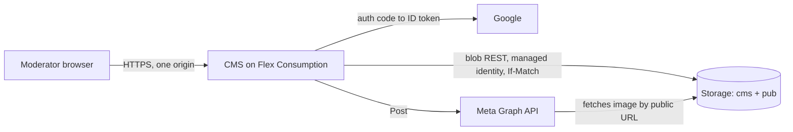

# Platform

Where folk-ms runs and how it is built: Azure hosting for the CMS and the Sites, the ports that keep the domain independent of Azure, the dependency policy, infrastructure as code, CI/CD and local development. Every capability builds on it.

## How it works

### Hosting

The read path and the write path are separate. Visitors only ever touch the Sites and the public `pub` container, so a CMS outage never takes a Site down; the Site keeps showing the last Publish.

- **CMS:** one Azure Functions Flex Consumption app running the Go binary as a custom handler with `enableProxyingHttpRequest: true` and `routePrefix: ""`. The admin SPA, the API and sign-in share one origin, so cookies are first-party (`SameSite=Lax`) and no CORS is needed. Same-origin also avoids the cross-site cookie problems of the `*.azurewebsites.net` public suffix. The free grant (100k GB-s, 250k executions) covers the admin traffic of a few Moderators. Scale-to-zero costs about 1–2 s on the first request, which is acceptable for an admin UI.
- **Sites:** Azure Static Web Apps Free, one app per Site, with no functions and no SWA auth. The free tier gives 10 apps, 100 GB a month and free TLS on two custom domains each.
- **Storage:** one storage account. The private container `cms` holds JSON documents (Events, Venues, users, Invitations, encrypted Meta tokens) and the Audit Log. The public container `pub` holds snapshots and media. Blob versioning and soft delete are on.
- **Data store:** JSON documents with optimistic concurrency through ETag and `If-Match`. Hundreds of Events need no query engine, and documents port to a filesystem or S3.

### Ports and adapters

The domain and the use cases depend only on ports. Only the composition root (`cms/cmd/cms`) picks adapters, from the environment (`azure` or `local`); it also detects whether it runs under the Functions host (`FUNCTIONS_CUSTOMHANDLER_PORT`) or as a plain server. Moving to a VPS changes that wiring and the deployment, not the domain.

| Port | Azure | VPS or local | Tests |
| --- | --- | --- | --- |
| `DocumentStore` (Get/Put with ETag, List by prefix, Delete) | blob REST, managed identity | files, atomic rename and lock file | memory |
| `PublicStore` (snapshots, media) | blob container `pub` | directory behind a web server | memory |
| `AppendLog` (Audit Log) | append blobs, one per day | `O_APPEND` file | memory |
| `IdentityProvider` | Google | Google, or the dev OIDC stub | stub |
| `SocialPublisher` | Meta Graph API | Meta Graph API | recorder |
| `Cipher` (AES-256-GCM) | key in app settings | key in environment | fixed key |
| `Clock`, `ImageProcessor` | | | |

All store adapters run one shared contract test suite; the blob adapter runs it against Azurite.

### Dependency policy

- **Go:** standard library and `golang.org/x/*` only, vendored with `go mod vendor`, checked with `govulncheck` in CI. No Azure SDK and no OIDC or JWT libraries: blob REST and ID-token verification are written by hand. One binary runs on Functions, a VPS or a container.
- **TypeScript** (admin SPA, Sites, contract reader): built with a pinned Bun binary, downloaded and checksum-verified by a script. Zero npm runtime dependencies; the only npm package is the dev-only `typescript` type-checker, at an exact version with lockfile integrity, installed with `npm ci --ignore-scripts`.
- **GitHub Actions:** only `actions/*`, pinned by commit SHA; Dependabot updates actions only.

### Infrastructure and CI/CD

Bicep in `infra/azure` declares the storage account (containers, CORS on `pub` for Site origins, versioning, soft delete, lifecycle), the Flex app with its system-assigned identity and `Storage Blob Data Contributor` role, and the two Static Web Apps. GitHub Actions deploys through OIDC federated credentials, so no Azure secret is stored. Secrets (token-encryption key, Google and Meta client secrets, `SUPER_ADMIN_EMAIL`) are app settings, set at deploy from GitHub secrets; none is in the repository.

Workflows: `ci.yml` (Go vet, test, vulncheck, vendor check; `tsc --noEmit`; Bun test and build; contract tests; Azurite tests; Bicep build), `deploy-infra.yml`, `deploy-cms.yml`, and `deploy-site.yml` as a matrix per Site with path filters.

### Local development

Filesystem and memory adapters plus a dev OIDC stub (guarded by a build tag) give a fast loop with no external dependencies. An Azurite container, pinned by digest, runs the Azure adapter contract tests locally (Rancher Desktop) and in CI.

### Cost

| Item | Basis | Monthly |
| --- | --- | --- |
| Static Web Apps Free × 2 | Free plan | $0 |
| Flex Consumption | Far below the free grant | $0 |
| Storage: deployment, data, media | Under 1 GB, under 100k transactions (unconfirmed third-party price data) | < $0.50 |
| Egress to visitors | Small snapshot; images are the main egress; first 100 GB free | ~$0 |
| Google OIDC, Meta app, GitHub Actions (public repository) | Free | $0 |
| **Total** | | **< $1** |

### Open risks

The spike retires the first two before anything else is built.

- **Flex catch-all routing.** Microsoft does not document whether a custom handler can serve arbitrary paths with `routePrefix: ""`; `/admin` and `/runtime` are likely reserved by the host. Fallback: Azure Container Apps running the same binary.
- **Meta Standard Access for `pages_manage_posts`.** Very likely fine for app-role holders, but not stated explicitly. See [Social posting](../social-posting/README.md).
- **Per-Organization CMS domains.** Flex allows at most 3 managed certificates per app, which is enough for 2–3 Organizations. Sessions are per host.
- **Single snapshot growth.** One `events.json` per Site is fine for years; revisit later.

## Where it lives

| What | Path |
| --- | --- |
| Composition root | `cms/cmd/cms/` |
| Ports | `cms/internal/ports/` |
| Adapters | `cms/internal/adapters/` (`azblob/`, `fs/`, `memory/`, `google/`, `devoidc/`, `meta/`, `img/`) |
| HTTP layer | `cms/internal/http/` |
| Vendored Go dependencies | `cms/vendor/` |
| Infrastructure | `infra/azure/main.bicep` |
| Workflows | `.github/workflows/` |

## Read next

- [Site delivery](../site-delivery/README.md): the read path in detail
- [Access](../access/README.md): sessions, cookies and CSRF
- [CONTEXT.md](../../CONTEXT.md)
