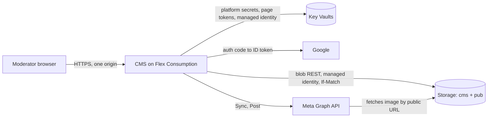

# Platform

Where folk-ms runs and how it is built: Azure hosting for the CMS and the Sites, the ports that keep the domain independent of Azure, the dependency policy, infrastructure as code, CI/CD and local development. Every capability builds on it.

## How it works

### Hosting

The read path and the write path are separate. Visitors only ever touch the Sites and the public `pub` container, so a CMS outage never takes a Site down; the Site keeps showing the last snapshot.

- **CMS:** one Azure Functions Flex Consumption app running the Go binary as a custom handler. `host.json` sets `routePrefix: ""` and request forwarding, and one HTTP function with the route `{*path}` hands every request to the binary; the timer function `purge` runs the daily Bin purge as `POST /purge` (03:30 UTC), and the timer function `sync` runs Autosync as `POST /sync` (hourly, at minute 7). Both routes are public through the catch-all, take no input and are bounded: purge by an in-memory interval, Sync by a lease in storage ([Sync](../sync/README.md#the-lease-t10)). The admin SPA, the API and sign-in share one origin, so cookies are first-party (`SameSite=Lax`) and no CORS is needed. Same-origin also avoids the cross-site cookie problems of the `*.azurewebsites.net` public suffix. The free grant (100k GB-s, 250k executions) covers the admin traffic of a few Moderators. Scale-to-zero costs about 1–2 s on the first request, which is acceptable for an admin UI. See [ADR 0004](../architecture/adr/0004-same-origin-admin-on-flex-custom-handler.md) for what the local spike verified and what remains to check in Azure.
- **Sites:** Azure Static Web Apps Free, one app per Site, with no functions and no SWA auth. The free tier gives 10 apps, 100 GB a month and free TLS on two custom domains each.
- **Storage:** one storage account with shared-key access disabled. The private container `cms` holds JSON documents (Events and their index documents, sync status, Social Post records, users, Invitations, Social Account Connections; never a Meta token, see [Social posting](../social-posting/README.md)) under `data/` and the Audit Log under `audit/`. The public container `pub` holds snapshots and media. Blob versioning and soft delete (30 days) are on; old versions expire after 90 days.
- **Data store:** JSON documents with optimistic concurrency through ETag and `If-Match`; see [ADR 0002](../architecture/adr/0002-blob-json-documents-with-etag.md).
- **Key Vaults:** two vaults with Azure RBAC and soft delete for 7 days, without purge protection ([ADR 0010](../architecture/adr/0010-autosync-keeps-a-page-token-in-key-vault.md)). The platform vault holds the Meta app secret and `SESSION_KEY` (the app settings hold Key Vault references to them); the CMS identity can only read it. The token vault holds the Facebook page token of each Organization with Autosync on, one secret each, under a name never reused; the CMS identity reads, writes, deletes and purges there. No person has a standing data role on either.
- **Identity:** the CMS runs as a user-assigned managed identity (`<prefix>-cms-id`), created once in the first-deployment runbook rather than by Bicep, so the deploy identity's role-assignment condition can name it and it survives the app being recreated (T4). It is used for the Functions host storage, the deployment package, Key Vault references and, through `AZURE_CLIENT_ID`, the CMS's own blob and Key Vault calls.
- **Monitoring:** both vaults' audit logs and the storage account's blob writes and deletes go to a Log Analytics workspace (`PerGB2018`, 30 days, 1 GB daily cap). A scheduled-query alert, evaluated every 15 minutes over the last hour, emails the Super Admin when either vault is used by an identity other than the CMS, the `cms` container is written by another identity, or page tokens are read more than 100 times in an hour (T8). A free Activity Log alert reports changes to role assignments, diagnostic settings, alert rules and vaults, and a budget reports costs at 50% and 100%. The runbook is in the [root README](../../README.md#key-vault-and-token-incident-response).

### Ports and adapters

The domain and the use cases depend only on ports ([`cms/internal/ports`](../../cms/internal/ports/ports.go)). Only the composition root ([`cms/cmd/cms`](../../cms/cmd/cms/main.go)) picks adapters, from `FOLKMS_ENV` (`azure` or `local`); it also detects whether it runs under the Functions host (`FUNCTIONS_CUSTOMHANDLER_PORT`) or as a plain server (`PORT`). Moving to a VPS changes that wiring and the deployment, not the domain.

| Port | Azure | VPS or local | Tests |
| --- | --- | --- | --- |
| `DocumentStore` (Get/Put with ETag, List by prefix, Delete) | blob REST, managed identity (`azblob`) | files, atomic rename and lock file (`fs`) | `memory` |
| `PublicStore` (snapshots, media) | blob container `pub` | directory served at `/pub/` | `memory` |
| `AppendLog` (Audit Log) | append blobs, one per day | `O_APPEND` file per day | `memory` |
| `IdentityProvider` | Google (`google`), Facebook (`meta.SignIn`) | Google and Facebook, or the dev OIDC stub for both (`devoidc`, build tag `dev`) | fake |
| `SocialPublisher` | Meta Graph API (`meta`) | Meta Graph API, or the recorder when `META_APP_ID` is unset | recorder |
| `FacebookEvents` (list and read Facebook Events, covers, Autosync's long-lived page token) | Meta Graph API (`meta`) | Meta Graph API, or the recorder with canned Facebook Events when `META_APP_ID` is unset | recorder |
| `SecretStore` (Get, Set, Delete by name) | Key Vault REST, managed identity (`keyvault`, `KEYVAULT_URL`) | `0600` file per secret (`secretfile`, `SECRETS_DIR`) | `memory` |
| `ImageProcessor` | `img` (JPEG, PNG, WebP in; JPEG out) | same | same |

All store adapters run one shared contract suite ([`storetest`](../../cms/internal/adapters/storetest/storetest.go)), the secret stores theirs ([`storetest/secrets.go`](../../cms/internal/adapters/storetest/secrets.go)); the blob adapter runs it against Azurite. The Key Vault adapter is stdlib only, like the blob adapter: REST with a token from the managed identity endpoint, the access token cached, secret values never.

### Dependency policy

See [ADR 0003](../architecture/adr/0003-stdlib-only-go.md) for what may be depended on and [ADR 0007](../architecture/adr/0007-latest-toolchains-and-dependabot-cooldown.md) for how versions are kept current. In short:

- **Go:** standard library and `golang.org/x/*` only, fetched as modules and verified by `go.sum`, checked with `govulncheck` in CI. CI builds with the latest stable Go. No Azure SDK, no Meta SDK and no OIDC or JWT libraries.
- **TypeScript** (admin SPA, Sites, contract reader): built, tested and served with Bun; CI installs the latest release with [`.github/scripts/setup-bun.sh`](../../.github/scripts/setup-bun.sh). Zero npm runtime dependencies; the only npm package is the dev-only `typescript` type-checker, locked with integrity in `package-lock.json` and installed with `npm ci --ignore-scripts`.
- **GitHub Actions:** only `actions/*`, pinned by commit SHA.
- **Updates:** Dependabot updates the actions, `typescript` and the Go modules with a 7-day cooldown ([`.github/dependabot.yml`](../../.github/dependabot.yml)). Azure sign-in uses the Azure CLI with the workflow's OIDC token, not a third-party action.

### Infrastructure and CI/CD

Bicep in [`infra/azure/main.bicep`](../../infra/azure/main.bicep) declares the storage account (containers, CORS on blobs for Site origins and each Static Web App's default `*.azurestaticapps.net` origin, versioning, soft delete, lifecycle), the Flex app running as the user-assigned CMS identity with `Storage Blob Data Owner` (the Functions host keeps its leases in the same account, which needs Owner), the platform Key Vault with `Key Vault Secrets User` and the token Key Vault with `Key Vault Secrets Officer`, both for the CMS identity only, the Log Analytics workspace with the vault and blob diagnostics, the alert rules, the action group and the budget, and one Static Web App per Site. GitHub Actions deploys through OIDC federated credentials, so no Azure secret is stored. The deploy identity has `Contributor` and a `Role Based Access Control Administrator` assignment conditioned to those three roles and the CMS identity, instead of `User Access Administrator` (T4). Secrets come from GitHub environment secrets at deploy: `META_APP_SECRET` and `SESSION_KEY` are written into Key Vault and referenced from the app settings; `GOOGLE_CLIENT_SECRET` and `SUPER_ADMIN_EMAIL` are app settings. None is in the repository. Details: [`infra/azure/README.md`](../../infra/azure/README.md).

Workflows in [`.github/workflows`](../../.github/workflows/):

- `ci.yml`: Go vet, test (with Azurite as a service), `govulncheck`, a check that `go.mod` and `go.sum` are tidy, a check that the production binary has no dev sign-in; `tsc -b`; Bun tests (contract reader, Site routes); admin and Site builds; Bicep build.
- `deploy-infra.yml`: `main.bicep` with Site ids and origins computed from `config/sites.json`.
- `deploy-cms.yml`: a `build` job (tests, `cms/deploy/package.sh`: Linux binary + `host.json` + function folders + `sites.json`) with no environment, secrets or OIDC token, then a `deploy` job in the `production` environment that runs only Azure CLI: zip deploy of the built package, health check.
- `deploy-site.yml`: a matrix of the Site ids in `config/sites.json`, with path filters; Sites are tested and built in jobs without Azure access (the snapshot URL is baked in at build time), and deployed in `production` jobs, where the Static Web Apps CLI runs after `az logout` and without access to the OIDC token.

Only the deploy jobs (and `deploy-infra`) name the `production` environment, which is limited to `main` with a required reviewer (T4).

### Local development

`scripts/dev.sh` builds the CMS to `.tools/cms-dev` and runs it on http://localhost:8080, listening on loopback only (`HOST=127.0.0.1`, so the Windows firewall does not prompt; `HOST=0.0.0.0` opens it to the network, e.g. to try it on a phone), with filesystem stores in `.data/`, the file secret store in `.data/secrets/`, the dev OIDC stub (any email signs in; `SUPER_ADMIN_EMAIL` defaults to `admin@example.org`) and the Meta recorder, which records Social Posts and gives Sync canned Facebook Events. It serves the public store at `/pub/` with the same cache headers and CORS as Azure, so a Site built by `bun sites/build.ts <site>` and served by `bun sites/serve.ts <site> 5173` reads its snapshot from the local CMS. An Azurite container, pinned by digest in `ci.yml`, runs the blob adapter tests; setting `STORAGE_BLOB_URL` and `STORAGE_ACCOUNT_KEY` runs the local CMS against it. Commands are in the [root README](../../README.md#local-development).

### Cost

| Item | Basis | Monthly |
| --- | --- | --- |
| Static Web Apps Free × 2 | Free plan | $0 |
| Flex Consumption | Far below the free grant, also with the hourly `sync` timer | $0 |
| Storage: deployment, data, media | Under 1 GB, under 100k transactions (unconfirmed third-party price data) | < $0.50 |
| Egress to visitors | Small snapshot; images are the main egress; first 100 GB free | ~$0 |
| Key Vault (Standard) | A few thousand operations | < $0.10 |
| Log Analytics workspace | A few MB of Key Vault audit log, inside the free monthly allowance | $0 |
| Alert rule (log search, every 15 minutes) and action group (email) | Decision 18 | $0.50–1.50 |
| Google OIDC, Meta app, GitHub Actions (public repository) | Free | $0 |
| **Total** | | **about $2** |

### Open risks

- **Flex specifics.** The catch-all route, cookie passthrough and the timer were verified on the Functions host locally (ADR 0004); `SameSite=Lax` after the Google redirect, cold start and managed identity still need a real Flex app. Fallback: Azure Container Apps running the same binary.
- **Meta Standard Access for `pages_manage_posts`.** Very likely fine for app-role holders, but not stated explicitly. See [Social posting](../social-posting/README.md).
- **Graph access to page events.** The spike showed that a Standard Access app reads its page's events with `pages_read_engagement` ([ADR 0009](../architecture/adr/0009-facebook-events-are-the-source-of-events.md)). Meta could close that, as it has closed other event endpoints; then Sync stops and Organizations fall back to Manual Events.
- **Residual risk of Autosync** ([ADR 0010](../architecture/adr/0010-autosync-keeps-a-page-token-in-key-vault.md)). Whoever can run code as the CMS, or deploy it, can post to the Facebook page and Instagram account of every Organization with Autosync on, until Autosync is off and the person who turned it on removes the app on Facebook, or the Meta app secret is rotated. Accepted; Organizations that leave Autosync off do not carry it. Detection is the alerts and the Audit Log. A read-only second Meta app for Sync would leave a stolen token only able to read public events; it needs a second app and review at Meta.
- **Flex Consumption scales to at least 40 instances.** Requests are rate limited per instance, so a flood can still cost money; the budget alert reports it.
- **Autosync needs a person every 90 days.** Meta ends the stored token's data access 90 days after the sign-in that issued it; the "reconnect before" banner asks for a new Meta sign-in from 14 days before.
- **Per-Organization CMS domains.** Flex allows at most 3 managed certificates per app, which is enough for 2–3 Organizations. Sessions are per host.
- **Single snapshot growth.** One `events.json` per Site is fine for years; revisit later.

## Where it lives

| What | Path |
| --- | --- |
| Composition root | [`cms/cmd/cms/`](../../cms/cmd/cms/) |
| Ports | [`cms/internal/ports/`](../../cms/internal/ports/) |
| Adapters | [`cms/internal/adapters/`](../../cms/internal/adapters/) (`azblob/`, `fs/`, `memory/`, `keyvault/`, `secretfile/`, `google/`, `devoidc/`, `meta/`, `img/`, `storetest/`) |
| HTTP layer | [`cms/internal/http/`](../../cms/internal/http/) |
| Functions package | [`cms/deploy/`](../../cms/deploy/) |
| Go dependencies | [`cms/go.mod`](../../cms/go.mod) |
| Dependency updates | [`.github/dependabot.yml`](../../.github/dependabot.yml) |
| Infrastructure | [`infra/azure/main.bicep`](../../infra/azure/main.bicep) |
| Workflows | [`.github/workflows/`](../../.github/workflows/) |

## Change together

| Rule | Files | What breaks |
| --- | --- | --- |
| The Functions package layout matches the binary | `cms/deploy/functions/host.json` (`defaultExecutablePath`), `cms/deploy/package.sh` | The host cannot start the handler; the deploy smoke test fails. |
| Each Static Web App carries the tag `folkms-site=<site id>` that the deploy finds it by | `infra/azure/main.bicep`, `.github/workflows/deploy-site.yml` | The Site deploy fails with "no Static Web App tagged". |
| The CMS identity's name and the roles `main.bicep` assigns match the deploy identity's role-assignment condition | `infra/azure/main.bicep` (`cmsIdentityName`, role assignments), the first-deployment runbook in the [root README](../../README.md#first-deployment) | `deploy-infra` is refused the role assignment. |
| The Key Vault alert's hourly threshold stays above how often the CMS normally reads page tokens | `infra/azure/main.bicep` (`maxSecretGetsPerHour`), `cms/internal/domain/sync.go` (`AutosyncInterval`, `SyncNowInterval`), `cms/internal/domain/social.go` (`DailyPostLimit`) | Normal use emails false alarms, or real misuse stays under the threshold. A page token is read only after the sync lease or the daily post limit lets the action run, so the most one Organization reads in an hour is one Autosync run, 60 "Sync now" runs (at most once a minute) and its posts (10 a day), under 100; several Organizations doing that in the same hour would pass it. |

## Read next

- [ADR 0010](../architecture/adr/0010-autosync-keeps-a-page-token-in-key-vault.md): Key Vault, the CMS identity and the alert
- [ADR 0002](../architecture/adr/0002-blob-json-documents-with-etag.md), [ADR 0003](../architecture/adr/0003-stdlib-only-go.md), [ADR 0004](../architecture/adr/0004-same-origin-admin-on-flex-custom-handler.md), [ADR 0007](../architecture/adr/0007-latest-toolchains-and-dependabot-cooldown.md)
- [Site delivery](../site-delivery/README.md): the read path in detail
- [Access](../access/README.md): sessions, cookies and CSRF
- [`infra/azure/README.md`](../../infra/azure/README.md): parameters and keys
- [CONTEXT.md](../../CONTEXT.md)
