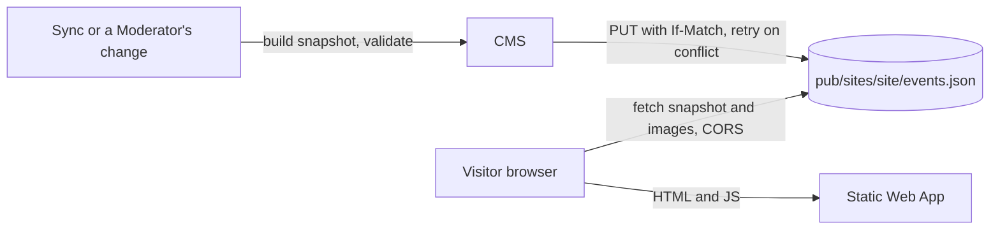

# Site delivery

How each Organization's static Site gets its Events without calling the CMS: whenever an Event changes, the CMS writes a per-Site JSON snapshot to the public container, and the Site reads it in the browser through a shared TypeScript reader. It uses the CMS, Storage, the contract and the Sites.

## How it works

Every change to an Event rebuilds the snapshot: a Sync run that changed something (once per run), a Moderator's Override, CMS-only field, Hide or Manual Event, a restore from the Bin. Visitors then read it straight from storage; there is no compute on the read path, so a CMS outage is not a Site outage.

- **Snapshot:** one `pub/sites/<site>/events.json` per Site with every Event of its Organization that is not Hidden and not in the Bin, with its effective values (the Override, else Facebook; the Moderator's values for a Manual Event; English from the CMS-only fields): Organization info, each Event's id, `shortId`, slug, Permalink, title, Summary, description, Price (text and tickets link), Cover Image variants with width, height and URL, its Occurrences, `updatedAt`, and `schemaVersion`. Each Occurrence has its start and end, `cancelled`, `online` when true, its Location and its required `facebookEventUrl`. Served with `Cache-Control: public, max-age=60`. The CMS also rebuilds every snapshot when it starts.
- **Schema version 2** replaced version 1 when Facebook Events became the source of Events: the `venues` map, `recurrence`, `kind` and `publishedAt` are gone; `updatedAt` replaces `publishedAt`; Location is free text on each Occurrence; every Occurrence links to its own Facebook Event (a repeating Facebook Event is one Event with several Occurrences). The reader refuses any other version, so the CMS and both Sites deploy together. Details: [`contract/README.md`](../../contract/README.md).
- **Concurrent rebuilds** write the snapshot with ETag compare-and-swap and retry on conflict; the snapshot's ETag is read before the Events, so a stale build never overwrites a fresher one.
- **Media:** JPEG variants under immutable, content-hashed names in `pub`.
- **Contract:** the hand-written JSON Schema `contract/events.schema.json` is canonical. The Go snapshot builder and the TypeScript reader are both tested against the shared fixtures. Because the Go side allows no third-party dependencies, the CMS has its own minimal validator for the keyword subset the schema uses, with a test that the schema uses no other keywords.
- **Reader:** `contract/client/` fetches the snapshot and provides hand-written types and helpers: upcoming and past split, language fallback, Occurrence listing, Permalink lookup by `shortId`, image variant choice.
- **Untrusted text:** Facebook text reaches the Sites (T7). The CMS keeps it plain and bounded and accepts only `https` links; the Sites escape all snapshot text and link only `https` addresses (`sites/shared/render.test.ts`).
- **Sites:** each Site is a Bun-built TypeScript skeleton with bilingual routes (`/pl/`, `/en/`, `/<lang>/events`, `/<lang>/events/past`, `/<lang>/events/<shortId>-<slug>`) through SWA `navigationFallback`. The shared router and plain page modules live in `sites/shared/`: each Site's entry composes `events()` (these routes) and, on Bal Folk Poznań, `videos()` (`/<lang>/videos`); a stale slug is corrected in the address bar. Designers own everything else. The snapshot URLs are set at build time (`SNAPSHOT_URL`, `VIDEOS_URL`).
- **Video Collection:** the CMS publishes a second snapshot per Site, `pub/sites/<site>/videos.json`, with its own schema and version, built the same way; see [Video Collection](../video-collection/README.md).
- **Link previews** are generic in v1: no prerendering and no per-Event Open Graph tags.

## Where it lives

| What | Path |
| --- | --- |
| Snapshot schema and fixtures | [`contract/events.schema.json`](../../contract/events.schema.json), [`contract/fixtures/`](../../contract/fixtures/) |
| Go validator for the schema | [`cms/internal/schema/`](../../cms/internal/schema/) |
| TypeScript reader | [`contract/client/`](../../contract/client/) |
| Snapshot builder and rebuild | [`cms/internal/domain/snapshot.go`](../../cms/internal/domain/snapshot.go), [`cms/internal/app/snapshot.go`](../../cms/internal/app/snapshot.go) |
| Organizations, Sites, origins, Permalink pattern | [`config/sites.json`](../../config/sites.json) |
| Sites | [`sites/shared/`](../../sites/shared/), [`sites/balfolk-poznan/`](../../sites/balfolk-poznan/), [`sites/celtycki-wroclaw/`](../../sites/celtycki-wroclaw/) |

## Change together

| Rule | Files | What breaks |
| --- | --- | --- |
| The schema, the Go snapshot builder and the TypeScript reader describe the same document, at the same `schemaVersion` | `contract/events.schema.json`, `contract/fixtures/`, `cms/internal/domain/snapshot.go`, `contract/client/`, `sites/shared/` | Sites fail to read or misread Events. Enforced in CI: `cms/internal/schema` validates the fixtures, `cms/internal/domain` validates a built snapshot against the schema, `contract/client/test` reads the fixtures. A new `schemaVersion` also needs the CMS and the Sites deployed together. |
| The Permalink pattern the CMS uses in Captions matches the Sites' routes | `config/sites.json`, `sites/shared/router.ts` | Social Posts link to pages that do not exist. Enforced by `sites/shared/router.test.ts` (and `cms/internal/config` tests the CMS side). |
| Every Site origin is allowed by CORS on `pub` | `config/sites.json`, `infra/azure/main.bicep` | The Site cannot fetch its snapshot. Enforced: `deploy-infra.yml` passes the origins from `config/sites.json`, and the local CMS applies the same list at `/pub/`; `main.bicep` adds each Static Web App's default `*.azurestaticapps.net` origin itself. |

## Read next

- [ADR 0001](../architecture/adr/0001-published-snapshot-delivery.md): why a snapshot
- [Event management](../event-management/README.md): effective values, Hide and the Bin
- [Sync](../sync/README.md): where most changes come from
- [`contract/README.md`](../../contract/README.md), [`sites/README.md`](../../sites/README.md): building and testing
- [CONTEXT.md](../../CONTEXT.md#site-delivery): the terms this capability uses
