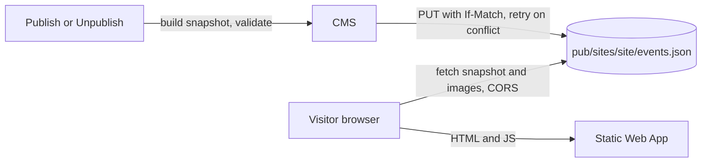

# Site delivery

How each Organization's static Site gets its Events without calling the CMS: on every Publish the CMS writes a per-Site JSON snapshot to the public container, and the Site reads it in the browser through a shared TypeScript reader. It uses the CMS, Storage, the contract and the Sites.

## How it works

Publish, Unpublish and Venue edits rebuild the snapshot. Visitors then read it straight from storage; there is no compute on the read path, so a CMS outage is not a Site outage.

- **Snapshot:** one `pub/sites/<site>/events.json` per Site with all Published Events of its Organization: Organization info, each Event's id, slug, Permalink, kind, expanded Occurrences (with cancellations and overrides), Polish and English texts with explicit fallback, Venue, Price, image variants with width, height and URL, `publishedAt` and `schemaVersion`. Served with `Cache-Control: public, max-age=60`.
- **Concurrent Publishes** rebuild the snapshot with ETag compare-and-swap and retry on conflict.
- **Media:** JPEG variants under immutable, content-hashed names in `pub`.
- **Contract:** the hand-written JSON Schema `contract/events.schema.json` is canonical. The Go snapshot builder and the TypeScript reader are both tested against the shared fixtures. Because the Go side allows no third-party dependencies, the CMS has its own minimal validator for the keyword subset the schema uses, with a test that the schema uses no other keywords.
- **Reader:** `contract/client/` fetches the snapshot and provides hand-written types and helpers: upcoming and past split, language fallback, Occurrence listing.
- **Sites:** each Site is a Bun-built TypeScript skeleton with bilingual routes (`/pl/`, `/en/`), an Event list and Permalink routes through SWA `navigationFallback`. Designers own everything else.
- **Link previews** are generic in v1: no prerendering and no per-Event Open Graph tags.

## Where it lives

| What | Path |
| --- | --- |
| Snapshot schema and fixtures | `contract/events.schema.json`, `contract/fixtures/` |
| TypeScript reader | `contract/client/` |
| Snapshot builder | `cms/internal/domain/` |
| Organizations, Sites, origins, Permalink pattern | `config/sites.json` |
| Sites | `sites/balfolk-poznan/`, `sites/celtycki-wroclaw/` |

## Change together

| Rule | Files | What breaks |
| --- | --- | --- |
| The schema, the Go snapshot builder and the TypeScript reader describe the same document | `contract/events.schema.json`, `contract/fixtures/`, `cms/internal/domain/`, `contract/client/` | Sites fail to read or misread Events. Enforced by the fixture tests in CI. |
| The Permalink pattern the CMS uses in Captions matches the Sites' routes | `config/sites.json`, `sites/<site>/` | Social Posts link to pages that do not exist. Not enforced yet: the Site scaffold should test its routes against `config/sites.json`; until it does, add a pointer in `sites/AGENTS.md`. |
| Every Site origin is allowed by CORS on `pub` | `config/sites.json`, `infra/azure/main.bicep` | The Site cannot fetch its snapshot. |

## Read next

- [Event management](../event-management/README.md): what Publish means
- [CONTEXT.md](../../CONTEXT.md#site-delivery): the terms this capability uses
