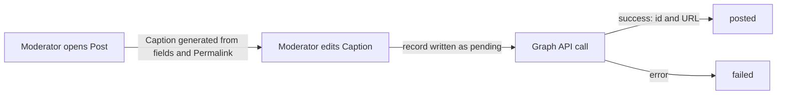

# Social posting

How a Moderator announces a Published Event on the Organization's Facebook Page and Instagram account. The CMS cannot create Facebook Events (the Graph API does not allow it), but it can publish Page feed posts and Instagram image posts. It uses the CMS, Storage and the Meta Graph API.

## How it works

### Social Account Connection

There is one Meta Business app with Standard Access, at no cost. The Super Admin adds each Moderator who will connect as a Tester on that app (a manual runbook step). That Moderator, who must administer the Organization's Page, connects it through Facebook Login; the CMS exchanges the long-lived user token for a Page token, looks up the linked Instagram account, and stores the tokens encrypted with AES-256-GCM in the `cms` container.

The connection belongs to the Organization, not to the person who made it. Any Moderator of the Organization can disconnect or reconnect it, and the Super Admin can disconnect it immediately. When the Moderator who created it loses access, the Super Admin and the Organization's Moderators see a "reconnect" warning.

### Posting

Posting is manual and per platform; Facebook and Instagram are independent. Only Published Events can be posted, because the Caption links to the Event's Permalink.

- Facebook gets a feed photo post with the Cover Image. Instagram gets an image post (container, then publish) with the Social Image, or a crop of the Cover Image, which Meta fetches by its public JPEG URL in `pub`.
- The record is written as `pending` before the Graph call, so a crash leaves an unknown outcome rather than a silent duplicate. A `pending` or failed post is retried only after the Moderator confirms it did not go out.
- The CMS checks Instagram's `/content_publishing_limit` before posting.
- Every post is appended to the Audit Log.
- The CMS serves the privacy policy and data deletion URLs that Meta requires.

The spike verifies, with a test Page, that Standard Access is enough for `pages_manage_posts`; see the open risks in [Platform](../platform/README.md#open-risks).

## Where it lives

| What | Path |
| --- | --- |
| Social Post record, confirmed-retry rule, Caption generator | `cms/internal/domain/` |
| Graph API adapter | `cms/internal/adapters/meta/` |
| Post dialog and connection screen | `cms/admin/` |

## Read next

- [Event management](../event-management/README.md): images and Publish
- [CONTEXT.md](../../CONTEXT.md#social-posting): the terms this capability uses
