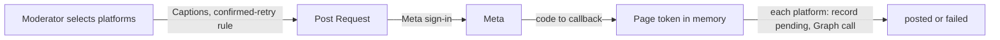

# Social posting

How a Moderator announces a Published Event on the Organization's Facebook Page and Instagram account. The CMS cannot create Facebook Events (the Graph API does not allow it), but it can publish Page feed posts and Instagram image posts. It uses the CMS, Storage and the Meta Graph API.

## How it works

The CMS stores no Meta token. A Moderator signs in with Meta every time they post, and the tokens Meta returns live only in the memory of the request that posts; see [ADR 0005](../architecture/adr/0005-meta-sign-in-for-every-post.md).

### Meta app and who can post

There is one Meta Business app with Standard Access, at no cost. The Super Admin adds each Moderator who will post as a Tester on that app (a manual runbook step). Their Meta account needs a role on the Organization's Page that allows posting, and access to its Instagram account. Taking any of these away, or the Moderator's CMS access, stops them posting at once; nothing in the CMS has to be reconnected.

### Social Account Connection

The connection records which Page and Instagram account the Organization posts to: their ids and names, and who chose them. A Moderator signs in with Meta, the CMS lists the Pages they have a role on (without their tokens) for 15 minutes, and the Moderator chooses one. The user token is dropped after the listing. The connection belongs to the Organization: any of its Moderators, or the Super Admin, can change or disconnect it.

### Posting

Posting is manual. In the Post dialog the Moderator edits a Caption per platform and selects Facebook, Instagram or both; one Meta sign-in posts every selected platform. Only Published Events can be posted, because the Caption links to the Event's Permalink.

- **Post Request.** Before leaving for Meta, the CMS checks what it can (Published Event, connection, images, Captions, the confirmed-retry rule) and keeps a Post Request with the Captions for 15 minutes. It holds no secret. The Meta `state` sits in a signed cookie bound to the CMS user, the Organization and the Post Request, and the request is used once. Abandoned requests are removed by the daily purge.
- **Callback.** `/auth/meta/callback` redeems the code for a short-lived user token, then asks Graph for the Page token of the connected Page. Graph gives it only when the Moderator has a role on the Page, which is the access check; otherwise nothing is posted. Instagram is posted only when the Page, as this Moderator sees it, links to the connected Instagram account. Both tokens are dropped when the request ends.
- **Each platform.** Facebook gets a feed photo post with the Cover Image. Instagram gets an image post (container, then publish) with the Social Image, or a crop of the Cover Image, which Meta fetches by its public JPEG URL in `pub`. The CMS checks Instagram's `/content_publishing_limit` first, and waits for the media container to be ready before publishing it. Graph calls carry `appsecret_proof`.
- **Outcomes.** The record is written as `pending` before the Graph call, so a crash leaves an unknown outcome rather than a silent duplicate. A `pending`, failed or posted platform is posted again only after the Moderator confirms. The callback returns to the Post dialog with each platform's outcome, or the reason nothing was sent.
- Locally, without `META_APP_ID`, a recorder replaces Meta: the whole flow works and nothing is sent.
- Every post, failure and refusal is appended to the Audit Log.
- The CMS serves the privacy policy and data deletion URLs that Meta requires.

The spike verifies, with a test Page, that Standard Access is enough for `pages_manage_posts`; see the open risks in [Platform](../platform/README.md#open-risks).

## Where it lives

| What | Path |
| --- | --- |
| Social Post record, confirmed-retry rule, Connection, Post Request | [`cms/internal/domain/social.go`](../../cms/internal/domain/social.go) |
| Caption generator | [`cms/internal/domain/caption.go`](../../cms/internal/domain/caption.go) |
| Use cases | [`cms/internal/app/social.go`](../../cms/internal/app/social.go) |
| Meta sign-in state and callback | [`cms/internal/http/auth.go`](../../cms/internal/http/auth.go), [`cms/internal/http/session.go`](../../cms/internal/http/session.go) |
| Graph API adapter and recorder | [`cms/internal/adapters/meta/`](../../cms/internal/adapters/meta/) |
| Post dialog and connection screen | [`cms/admin/src/views/post.ts`](../../cms/admin/src/views/post.ts), [`cms/admin/src/views/social.ts`](../../cms/admin/src/views/social.ts) |

## Change together

| Rule | Files | What breaks |
| --- | --- | --- |
| The Meta callback's outcome codes have a message in the Post dialog | `cms/internal/app/social.go` (`Refused*`), `cms/internal/http/auth.go` (`completePost`), `cms/admin/src/views/post.ts` | The Moderator sees a generic message instead of the reason. Enforced by `TestPostOutcomesMatchAdmin` in `cms/internal/http`. |

## Read next

- [Event management](../event-management/README.md): images and Publish
- [ADR 0005](../architecture/adr/0005-meta-sign-in-for-every-post.md): why the CMS stores no Meta token
- [Root README](../../README.md#operations): Meta app setup and who can post
- [CONTEXT.md](../../CONTEXT.md#social-posting): the terms this capability uses
