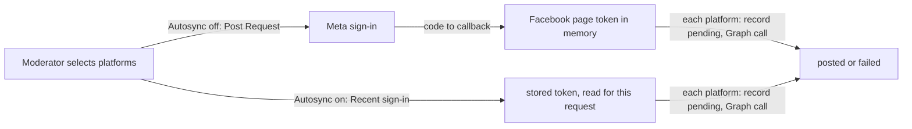

# Social posting

How a Moderator announces an Event on the Organization's Facebook page and Instagram account, and the Social Account Connection that says which page and account those are, with its Autosync switch. The CMS cannot create Facebook Events (Meta allows that only to approved ticketing partners); it publishes Facebook page feed posts and Instagram image posts. It uses the CMS, Storage, the Meta Graph API and, while Autosync is on, the secret store.

## How it works

### Meta app and permissions

There is one Meta Business app with Standard Access, at no cost. The Super Admin adds each Moderator who connects a Facebook page, runs "Sync now", turns Autosync on, posts or signs in with Facebook as a Tester on that app (a manual runbook step). Their Meta account needs a role on the Organization's Facebook page that allows posting, and access to its Instagram account.

The Meta sign-in asks only for `pages_show_list`, `pages_read_engagement` (enough to read the page's events), `pages_manage_posts`, `instagram_basic` and `instagram_content_publish`; `business_management` is no longer requested (T12). "Require App Secret" is on for the app, and every Graph call carries `appsecret_proof`, so a token alone is useless without the app secret (T2).

### Social Account Connection

The connection records which Facebook page and Instagram account the Organization syncs from and posts to: their ids and names, who chose them and when, and the Autosync state. A Moderator signs in with Meta, the CMS lists the Facebook pages they have a role on (without their tokens) for 15 minutes, and the Moderator chooses one; the user token is dropped after the listing. The connection belongs to the Organization: any of its Moderators, or the Super Admin, can replace or disconnect it, and every change is in the Audit Log. Replacing it with a different Facebook page asks for confirmation naming both pages; the old page's Events stay, frozen (decision 17, see [Sync](../sync/README.md#former-page-decision-17)).

### Autosync

Autosync is an Organization's opt-in to hourly Sync, off by default ([ADR 0010](../architecture/adr/0010-autosync-keeps-a-page-token-in-key-vault.md)). While it is off the CMS stores nothing from Meta, as under [ADR 0005](../architecture/adr/0005-meta-sign-in-for-every-post.md): every Sync and every Social Post goes through a Meta sign-in.

- **Turning it on** needs a Recent sign-in and a warning saying what is stored, what it allows and that someone must sign in with Meta again at least every 90 days. Then a Meta sign-in by someone with a role on the page: the code becomes a user token, exchanged for a long-lived one, from which the Facebook page token is derived; it is stored in the secret store under a new name, and both user tokens are dropped. The connection records the secret's name, who turned Autosync on and when, and `data_access_expires_at`; never the token. Turning it on again replaces the token and the date and deletes the previous secret.
- **Turning it off** needs a Recent sign-in and deletes the secret at once. So does replacing or disconnecting the connection, which turns Autosync off first.
- **Secret names are never reused.** Each turn-on stores the token under a fresh name (`fbpage-<org>-<random>`). Key Vault keeps a deleted secret in soft delete for 7 days, and a fresh name means the CMS never needs a purge right (T11).
- **Data access expiry.** The token itself does not expire, but Meta stops letting it read data 90 days after the sign-in that issued it. From 14 days before, the CMS shows a "reconnect before" banner; turning Autosync on again renews it.
- **Needs reconnect.** When Graph rejects the stored token (revoked, the role lost, the app removed, data access expired), the connection is marked "needs reconnect": hourly Sync skips the Organization and a banner asks for Autosync to be turned on again.
- **Losing access (decision 19).** When the person who turned Autosync on loses CMS access to the Organization (the Super Admin revokes them or removes the Organization from their access), Autosync turns off at once and the secret is deleted. The Organization falls back to "Sync now" and a Meta sign-in per post, and a banner asks another Moderator to turn Autosync on again.
- **A page token cannot revoke itself.** The connection screen names the person who turned Autosync on: to kill the token at Meta, they remove the app under Facebook, Settings, Business integrations. A leftover token is useless without the app secret (T2).

### Posting

Posting is manual. In the Post dialog the Moderator edits a Caption per platform and selects Facebook, Instagram or both. Captions are generated from the Event's effective values (Overrides, CMS-only fields, the next Occurrence, Location, Price, Summary, Permalink); Manual Events are posted like synced ones. Hidden Events and Events in the Bin cannot be posted, because the Caption links to the Event's Permalink.

There are two ways, chosen by Autosync:

- **Autosync off ([ADR 0005](../architecture/adr/0005-meta-sign-in-for-every-post.md)).** Before leaving for Meta, the CMS checks what it can (the Event is on the Site, connection, images, Captions, the confirmed-retry rule) and keeps a Post Request with the Captions for 15 minutes. It holds no secret. The Meta `state` sits in a signed cookie bound to the CMS user, the Organization and the Post Request, and the request is used once. `/auth/meta/callback` redeems the code for a short-lived user token, then asks Graph for the token of the connected Facebook page. Graph gives it only when the Moderator has a role on the page, which is the access check. Instagram is posted only when the page, as this Moderator sees it, links to the connected Instagram account. Both tokens are dropped when the request ends. Abandoned requests are removed by the daily purge.
- **Autosync on (ADR 0010).** Posting is one request: it needs a Recent sign-in ([Access](../access/README.md#recent-sign-in)), then reads the stored token for this request only and posts. The API never returns the token.
- **Daily limit.** Each Organization may attempt at most 10 Social Posts a day (UTC), in both ways; each selected platform counts.
- **Each platform.** Facebook gets a feed photo post with the Cover Image. Instagram gets an image post (container, then publish) with the Social Image, or a crop of the Cover Image, which Meta fetches by its public JPEG URL in `pub`. The CMS checks Instagram's `/content_publishing_limit` first, and waits for the media container to be ready before publishing it.
- **Outcomes.** The record is written as `pending` before the Graph call, so a crash leaves an unknown outcome rather than a silent duplicate. A `pending`, failed or posted platform is posted again only after the Moderator confirms. The Post dialog shows each platform's outcome, or the reason nothing was sent.
- Every post, failure and refusal is appended to the Audit Log, with whether the stored token or a sign-in was used.
- Locally, without `META_APP_ID`, a recorder replaces Meta: the whole flow works and nothing is sent.
- The CMS serves the privacy policy (`/privacy`) and data deletion (`/data-deletion`) pages Meta requires. They say that a Facebook page token is kept only while Autosync is on, what it is used for and how to remove it.

## Where it lives

| What | Path |
| --- | --- |
| Social Post record, confirmed-retry rule, Connection, Autosync, daily limit, Post Request | [`cms/internal/domain/social.go`](../../cms/internal/domain/social.go) |
| Caption generator | [`cms/internal/domain/caption.go`](../../cms/internal/domain/caption.go) |
| Connection and Autosync use cases | [`cms/internal/app/connection.go`](../../cms/internal/app/connection.go) |
| Posting use cases | [`cms/internal/app/posting.go`](../../cms/internal/app/posting.go) |
| Meta sign-in state and callback; privacy and data deletion pages | [`cms/internal/http/auth.go`](../../cms/internal/http/auth.go), [`cms/internal/http/session.go`](../../cms/internal/http/session.go) |
| Graph API adapter, scopes and recorder | [`cms/internal/adapters/meta/`](../../cms/internal/adapters/meta/) |
| Secret store port and adapters | [`cms/internal/ports/secrets.go`](../../cms/internal/ports/secrets.go), [`cms/internal/adapters/keyvault/`](../../cms/internal/adapters/keyvault/), [`cms/internal/adapters/secretfile/`](../../cms/internal/adapters/secretfile/) |
| Post dialog and connection screen | [`cms/admin/src/views/post.ts`](../../cms/admin/src/views/post.ts), [`cms/admin/src/views/social.ts`](../../cms/admin/src/views/social.ts) |

## Change together

| Rule | Files | What breaks |
| --- | --- | --- |
| The posting outcome codes have a message in the Post dialog | `cms/internal/app/posting.go` (`Refused*`), `cms/internal/http/auth.go` (`completePost`), `cms/admin/src/views/post.ts` | The Moderator sees a generic message instead of the reason. Enforced by `TestPostOutcomesMatchAdmin` in `cms/internal/http` (it does not yet list `limit`, `token` and `error`). |
| The scopes the CMS requests are permissions the Meta app has | `cms/internal/adapters/meta/meta.go` (`Scopes`), the [Meta app runbook](../../README.md#meta-app) | Meta refuses the sign-in with "Invalid Scopes". |

## Read next

- [Sync](../sync/README.md): what the connection's Facebook page is read for
- [Event management](../event-management/README.md): effective values, Hide and the Bin
- [ADR 0005](../architecture/adr/0005-meta-sign-in-for-every-post.md): a Meta sign-in for every post, which still holds while Autosync is off
- [ADR 0010](../architecture/adr/0010-autosync-keeps-a-page-token-in-key-vault.md): Autosync and its zero-trust audit
- [Root README](../../README.md#operations): Meta app setup, connecting a Facebook page, who can post, token incident response
- [CONTEXT.md](../../CONTEXT.md#social-posting): the terms this capability uses
