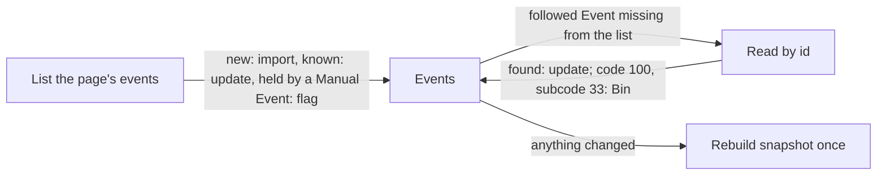

# Sync

How the CMS pulls an Organization's Facebook Events into Events: on demand when a Moderator presses "Sync now", and hourly for Organizations that turned Autosync on. Facebook is the source of Events ([ADR 0009](../architecture/adr/0009-facebook-events-are-the-source-of-events.md)); the CMS never creates, changes or removes a Facebook Event. Sync uses the CMS, Storage, the Meta Graph API, the secret store (Autosync only) and the admin SPA.

## How it works

### Triggers and tokens

Sync reads with the Facebook page token of the connected Facebook page (see the Social Account Connection in [Social posting](../social-posting/README.md#social-account-connection)). Where that token comes from depends on Autosync:

- **Autosync off** (the default): the CMS stores nothing from Meta. "Sync now" sends the Moderator to a Meta sign-in; the callback `/auth/meta/callback` redeems the code for a user token, asks Graph for the token of the connected Facebook page (Graph gives it only to someone with a role on the page), runs the Sync with it in memory and drops both. This Sync Request lives only in the signed Meta state cookie, bound to the CMS user and the Organization, and is used once; unlike a Post Request, nothing is stored. The Event list shows when the last Sync ran, since nothing updates unattended.
- **Autosync on**: "Sync now" (`POST /api/orgs/{org}/sync`) runs at once with the stored token, read from the secret store for that run only ([ADR 0010](../architecture/adr/0010-autosync-keeps-a-page-token-in-key-vault.md)). The hourly timer function `sync` (`0 7 * * * *`) calls `POST /sync`, which syncs every Organization with Autosync on whose last run started at least 50 minutes ago and whose connection does not need reconnecting. The Super Admin can start the same with `POST /api/admin/autosync`.

"Sync now" is open to any Moderator of the Organization and the Super Admin, at most once a minute per Organization. With Autosync off the interval is checked before the Moderator is sent to Meta, so nobody signs in for nothing.

When Graph rejects the stored token (code 190: revoked, the role lost, the app removed, data access expired), the run fails, the connection is marked "needs reconnect", hourly Autosync skips it and the CMS shows a reconnect banner until someone turns Autosync on again. Turning it on is also how the 90-day data access is renewed; see [Social posting](../social-posting/README.md#autosync).

### The lease (T10)

`POST /sync` is public, like `POST /purge`: the Functions host cannot attach a secret to a timer call, and the catch-all HTTP route exposes it. It takes no input. One instance scans the Organizations at most once every 5 minutes, and the app can scale out, so the real bound lives in storage: each run first claims the Organization's sync status document `orgs/{org}/sync/status.json` with its ETag. The document holds a 5-minute lease and the time of the last run; a run that finds the lease held, or the last run too recent (1 minute for "Sync now", 50 minutes for Autosync), does nothing. The stored token is read only after the claim succeeds, so calling `/sync` or "Sync now" repeatedly multiplies neither Graph calls nor Key Vault reads. The answer to `/sync` never carries error details; they go to the log. The same document records the first Sync, the last run and who ran it (a user or `autosync`), the last success, the last error and the counts of the last run; the Event list shows them.

### One run

1. **List.** `GET /{page-id}/events` with `include_canceled=true` (without it Graph leaves cancelled events out) and the fields `id, name, description, start_time, end_time, place, cover, ticket_uri, is_canceled, updated_time, event_times, is_online`, 50 per page, at most 20 pages. Every Graph call carries `appsecret_proof`.
2. **Each listed Facebook Event** becomes the Facebook part of an Event. A repeating Facebook Event lists its dates in `event_times`, each with its own id: one Event, one Permalink, one Occurrence per date, each linking to its own Facebook Event. Otherwise the Event has one Occurrence; a missing end equals the start. The place becomes the Location: its name, an address from street, postcode and city, and an OpenStreetMap link when Graph gives coordinates. All of it is untrusted (T7): plain text within length limits, `https` links only, at most 100 Occurrences.
   - **New:** imported only if it has not ended yet; there is no history backfill. A create-only index document `orgs/{org}/facebook-events/{id}.json` claims the Facebook Event id for the new Event, so two runs racing can never make one Facebook Event two Events or two Permalinks; the loser updates the winner's Event instead.
   - **Known and followed:** its Facebook part is replaced with ETag retry. Sync writes only that part, so it never loses a Moderator's Override, CMS field or Hide. An Event is followed while it comes from the connected Facebook page and until one day after its last Occurrence ends; after that it stays as it was.
   - **Held by a Manual Event:** left alone; the Manual Event is flagged in the Event list (see [Event management](../event-management/README.md#manual-events)).
3. **Missing from the list.** Every followed Event of the connected page that the list did not return, and that is not in the Bin, is read by id. Found: updated as above. Graph answers a deleted event with code 100, subcode 33, the same answer as for a missing permission; it counts as gone only because the list in the same run succeeded with the same token (decision 11). Then the Event moves to the Bin (`event.gone` in the Audit Log). A rejected token ends the run; any other error, a network error or an empty answer changes nothing and is listed in the run's errors. A gone Event that Facebook lists again comes back out of the Bin.
4. **Covers.** A cover is imported when the Facebook cover id changes, never otherwise: downloaded only over `https` from Facebook's CDN hosts (`*.fbcdn.net`, no redirect elsewhere), at most 10 MB, and re-encoded by the image processor into the JPEG variants in `pub` that every Cover Image has (Facebook's CDN links expire). A failed import is a run error; the Event is saved without the new cover.
5. **Finish.** The snapshot is rebuilt once if anything changed ([Site delivery](../site-delivery/README.md)). The status document is written and the run is in the Audit Log (`sync.ran` or `sync.failed`, with the counts and whether the stored token or a sign-in was used); each new Event is `event.imported`.

### Former page (decision 17)

Each Event remembers the Facebook page it was synced from, and Sync follows only Events of the page connected now. When the connection is replaced with another Facebook page (the screen asks for confirmation naming both pages), everything is kept: the old page's Events stay on the Site as they were, flagged "from a former page", and are no longer synced. The Moderator hides what is unwanted. Manual Events are unaffected.

### What Sync cannot read

An event another Facebook page created, even one the Organization's page co-hosts, is neither listed nor readable by id: that needs Page Public Content Access, out of scope for this app, and Meta refuses `user_events`. A Moderator enters such an event as a Manual Event. Graph never returns `owner`, so the host is not visible either.

### Locally

Without `META_APP_ID`, a `dev` build uses the Meta recorder (`meta.Recorder`) instead of Graph. Its Facebook page "Strona testowa" (id `1001`) has three canned Facebook Events dated from today: a single bal with a place and a ticket link, a repeating jam with two dates and a cancelled online concert. An id not among them reads as gone, so the gone rule can be tried by hand. Turning Autosync on stores a fake token in the file secret store under `.data/secrets/`.

### Spike results

A spike on 2026-11-13 (Graph v24.0, a test Facebook page, Standard Access, the Moderator as Tester) confirmed that the page token lists the page's events with `pages_read_engagement`, which fields Graph fills, that `event_times` gives each date of a repeating event its own readable id, the code 100, subcode 33 answer for a deleted event, that co-hosted events created elsewhere cannot be read, that a page token derived from a long-lived user token never expires but loses data access 90 days after the sign-in, and that "Require App Secret" refuses calls without `appsecret_proof`. One full run made about 30 Graph calls, far from any rate limit. Details and the decisions they led to: [ADR 0009](../architecture/adr/0009-facebook-events-are-the-source-of-events.md).

## Where it lives

| What | Path |
| --- | --- |
| Facebook part, sanitizing, `ApplyFacebook`, lease, intervals | [`cms/internal/domain/sync.go`](../../cms/internal/domain/sync.go) |
| Followed, Occurrences, effective values | [`cms/internal/domain/event.go`](../../cms/internal/domain/event.go) |
| Sync runs, "Sync now", Autosync of all Organizations, the gone rule | [`cms/internal/app/sync.go`](../../cms/internal/app/sync.go) |
| Index documents and storage keys | [`cms/internal/app/events.go`](../../cms/internal/app/events.go), [`cms/internal/app/app.go`](../../cms/internal/app/app.go) |
| The `FacebookEvents` port | [`cms/internal/ports/facebook.go`](../../cms/internal/ports/facebook.go) |
| Graph calls, covers, error mapping; the recorder and its canned events | [`cms/internal/adapters/meta/events.go`](../../cms/internal/adapters/meta/events.go), [`cms/internal/adapters/meta/meta.go`](../../cms/internal/adapters/meta/meta.go) |
| Routes: `POST /api/orgs/{org}/sync`, `POST /sync`, the Meta callback | [`cms/internal/http/api.go`](../../cms/internal/http/api.go), [`cms/internal/http/server.go`](../../cms/internal/http/server.go), [`cms/internal/http/auth.go`](../../cms/internal/http/auth.go) |
| Hourly timer | [`cms/deploy/functions/sync/function.json`](../../cms/deploy/functions/sync/function.json) |
| Sync status and "Sync now" in the Event list | [`cms/admin/src/views/events.ts`](../../cms/admin/src/views/events.ts) |

## Change together

| Rule | Files | What breaks |
| --- | --- | --- |
| The timer runs more often than the Autosync interval, and that interval stays under an hour | `cms/deploy/functions/sync/function.json` (`schedule`), `cms/internal/domain/sync.go` (`AutosyncInterval`) | With an interval of an hour or more, each hourly run finds the last one too recent and Autosync runs every other hour, silently. |
| The "Sync now" and Autosync callback outcomes have a message in the SPA | `cms/internal/http/auth.go` (`completeSync`: `sync=ok,page,too_soon,running,error,cancelled`; `completeAutosync`: `autosync=on,page,recent_sign_in,error,cancelled`), the Event list and connection screen in `cms/admin/src/views/` | The Moderator sees no message or a generic one after the Meta sign-in. Not enforced by a test yet. |

How often the CMS reads a stored token is bound to the Key Vault alert: see [Platform, Change together](../platform/README.md#change-together).

## Read next

- [Event management](../event-management/README.md): what a Moderator does with synced Events, Manual Events and the Bin
- [Social posting](../social-posting/README.md): the Social Account Connection and Autosync
- [ADR 0009](../architecture/adr/0009-facebook-events-are-the-source-of-events.md): Facebook Events are the source of Events, with the spike results
- [ADR 0010](../architecture/adr/0010-autosync-keeps-a-page-token-in-key-vault.md): Autosync keeps a Facebook page token in Key Vault
- [CONTEXT.md](../../CONTEXT.md#event-management): Sync, Autosync, Facebook Event, Occurrence
